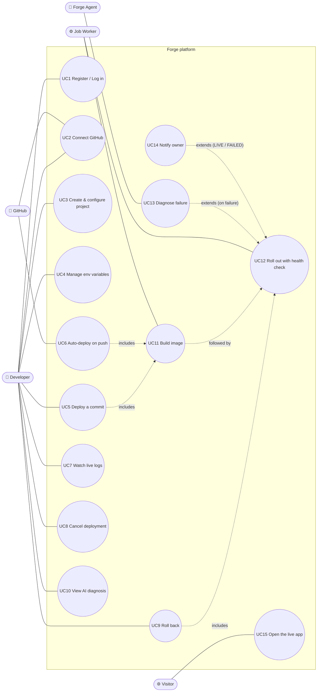

# 01 — Requirement Analysis

> Rubric item 1: functional and non-functional requirements, use cases and actors.

## 1. Problem

Putting a web app online normally means writing a Dockerfile, building and pushing an image, renting a server, running the container with the right secrets, putting a reverse proxy in front, and watching logs. When a deploy breaks, beginners are stuck reading cryptic logs while their site is down.

**Forge** is a small Render/Railway-style platform: connect a Git repository, click **Deploy** (or just `git push`), and Forge builds the exact commit into a container, starts it, health-checks it, and switches traffic to it only if it is healthy. When a deployment fails, the **Forge agent** reads the evidence and explains the root cause in plain language, with a suggested fix.

## 2. Actors

| Actor | Type | Description |
|-------|------|-------------|
| **Developer** | Primary, human | Owns projects; deploys, configures, rolls back, reads logs and diagnoses |
| **GitHub** | External system | Hosts the code; authenticates users (OAuth); sends push webhooks |
| **Forge Agent** | Internal autonomous actor | Observes failed deployments, reasons about the cause, reports a diagnosis. Never changes anything without the developer. |
| **Job Worker** | Internal system actor | Background worker that executes build and deploy jobs from the queue |
| **Container engine / Traefik** | External system (data plane) | Runs the app containers (Apple container by default, one lightweight VM per app; Docker as the alternative) and routes `<slug>.localhost` traffic to them |
| **Visitor** | Secondary, human | Uses the deployed app through its public URL |
| **Mail server** | External system | Delivers deployment notifications |

## 3. Use case diagram

## 4. Use case specifications

### UC5 — Deploy a commit (the core use case)

| | |
|---|---|
| **Primary actor** | Developer |
| **Preconditions** | Logged in; owns the project; repository reachable |
| **Trigger** | Clicks **Deploy** (`POST /projects/{id}/deployments`) |
| **Main flow** | 1. Forge resolves the branch head to an exact commit SHA. 2. Forge records a `QUEUED` deployment and a BUILD job **in one transaction**, cancelling older still-queued deployments. 3. API answers **202 Accepted** immediately. 4. A worker claims the job → `BUILDING`: clone that SHA, detect the stack, build the image. 5. → `DEPLOYING`: start the new container next to the old one. 6. → `HEALTH_CHECKING`: poll the health path. 7. Healthy → `LIVE`; the previous deployment becomes `SUPERSEDED` and its container is stopped. 8. Owner is notified. |
| **Alternative flows** | 4a. Another deployment of the project is running → the job is postponed, not failed. 4b. Build fails → `FAILED (BUILD_FAILED)`; the agent diagnoses (UC13). 6a. Unhealthy or crashed → the new container is removed, `FAILED (UNHEALTHY)`, **the old version keeps serving**; the agent diagnoses. 4c/5a. The container engine is temporarily unavailable → the job is retried with exponential backoff, then dead-lettered → `FAILED (RUNTIME_ERROR/INTERNAL_ERROR)`. |
| **Postconditions** | Exactly one LIVE deployment per project (or the previous one if this failed); full audit trail in `deployment_events`. |

### UC6 — Auto-deploy on push
GitHub sends a `push` webhook → Forge verifies the **HMAC-SHA256 signature**, ignores duplicate delivery ids, and queues a deployment (trigger `WEBHOOK`) for every project with auto-deploy enabled on that repository and branch. Tag pushes and branch deletions are ignored.

### UC9 — Roll back
Precondition: the target deployment has an image and was `LIVE`, `SUPERSEDED` or `STOPPED`. Forge creates a **new** deployment (trigger `ROLLBACK`) that reuses the old image and **skips the build** (`QUEUED → DEPLOYING`), then follows the normal rollout. History stays append-only.

### UC13 — Diagnose failure (Forge Agent)
Trigger: any deployment enters `FAILED`. The agent **observes** (failure reason and detail, project settings, last 150 log lines with secrets redacted), **reasons** (asks the LLM engine if configured, otherwise or on error the rule engine), and **reports** (stores an insight with category, summary, suggested fix, confidence and evidence lines; writes a 🤖 line into the deployment log). It recommends; it never redeploys or rolls back on its own.

### UC8 — Cancel deployment
Allowed only in `QUEUED` or `BUILDING` (409 otherwise). A cancelled build's image is discarded.

## 5. Functional requirements

| ID | Requirement | Where in code |
|----|-------------|---------------|
| FR-1 | Register and log in with email and password. BCrypt hashing. 15-minute JWT access tokens and 30-day rotating refresh tokens with reuse detection. | `identity` |
| FR-2 | Connect GitHub with OAuth (CSRF `state`). The token is stored AES-256-GCM encrypted. List repos and branches. | `source` |
| FR-3 | Project CRUD: name, unique DNS-safe slug, repo, branch, root dir, build type, port, health path, auto-deploy. Owner-only access. | `project` |
| FR-4 | Environment variables are encrypted at rest, masked when read, and decrypted only when a container starts. | `project` |
| FR-5 | A deploy request pins a commit, records `QUEUED` and the job atomically, and returns `202`. | `deployment` |
| FR-6 | Build pipeline: shallow clone of the exact SHA → detect the stack (Dockerfile / Maven / Gradle / Node) → generate a Dockerfile if needed → build the image with the container engine (`container build`; `docker build` on the Docker engine). The image stays in the engine's local store; it is pushed only if a registry is configured. | `build`, `source` |
| FR-7 | Every deployment follows the state machine. Illegal transitions are rejected and every transition is audited. | `deployment.domain` |
| FR-8 | Blue-green rollout: a new container is health-checked before the old one is stopped. A failure leaves the old one serving. | `deployment.application.BlueGreenRollout` |
| FR-9 | Live build/deploy logs over Server-Sent Events, with resume (`Last-Event-ID`), and live runtime logs of the running app. | `logs`, `deployment` |
| FR-10 | Signed, de-duplicated GitHub push webhooks trigger auto-deploys. | `source` |
| FR-11 | At most one in-progress deployment per project. Newer requests supersede queued ones. | `deployment` + DB index |
| FR-12 | Rollback to a previous image without rebuilding. | `deployment` |
| FR-13 | Cancel a queued or building deployment. | `deployment` |
| FR-14 | AI failure diagnosis with evidence, using rules plus an optional LLM. | `agent` |
| FR-15 | Email notification when a deployment goes LIVE or FAILED. | `notification` |
| FR-16 | Web dashboard for all of the above. | `forge-dashboard` |

## 6. Non-functional requirements

| Category | Requirement | How it is met |
|----------|-------------|---------------|
| **Availability** | A failed deploy never takes the live version down | Blue-green rollout. The old container is stopped only after the new one is LIVE. |
| **Reliability** | No deployment is lost if a worker crashes. No duplicate deploys. | Job leases + reaper. Idempotency keys on jobs. Webhook delivery de-duplication. Partial unique index. |
| **Responsiveness** | Deploy API answers in milliseconds | Slow work is asynchronous (job queue). The API only records intent. |
| **Scalability** | More throughput by adding workers | `FOR UPDATE SKIP LOCKED` lets any number of workers share one queue. A semaphore bounds work per instance. |
| **Security** | No plaintext secrets at rest, in logs, or in prompts | BCrypt, hashed refresh tokens, AES-GCM, an HMAC-verified webhook, ownership checks (404 not 403), secret redaction before the agent sees logs, resource-limited containers |
| **Observability** | Every log line is traceable | Correlation id per request and deployment id per job in the MDC. Micrometer metrics at `/actuator/prometheus`. |
| **Maintainability** | Modules cannot silently couple | Spring Modulith and ArchUnit tests fail the build on boundary violations |
| **Testability** | Core logic tested against real infrastructure | 114 tests: unit, integration against a real Postgres (local or Testcontainers), architecture |
| **Portability** | One command starts the infrastructure; the container engine is swappable | `scripts/infra.sh up` (Apple container, default). `forge.engine=docker` + `infra/docker-compose.yml` on Linux and CI. |

## 7. Scope

**In scope (built):** everything in §5.

**Out of scope (future work, presented on the "how it scales" slide):** Kafka instead of the Postgres queue, Redis (rate limiting, idempotency keys, multi-instance log fan-out), Kubernetes runtime, AWS deployment, autoscaling, teams and billing, microVM isolation for untrusted code on the Docker engine (Apple container already runs each app in its own VM).

## 8. Supported app types

| Build type | Detected by | How Forge builds it |
|------------|-------------|---------------------|
| `DOCKERFILE` | `Dockerfile` | Uses it unchanged (always wins) |
| `MAVEN` | `pom.xml` | Generated multi-stage Dockerfile: Maven 3.9 / JDK 21 → JRE 21, non-root |
| `GRADLE` | `build.gradle(.kts)` | Generated multi-stage Dockerfile: Gradle 8 / JDK 21 → JRE 21, non-root |
| `NODE` | `package.json` | Generated Dockerfile: Node 22, `npm ci`, optional build, `npm start` |
