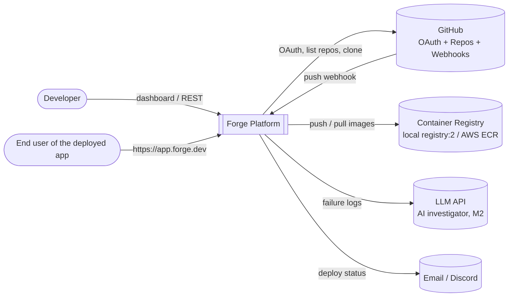
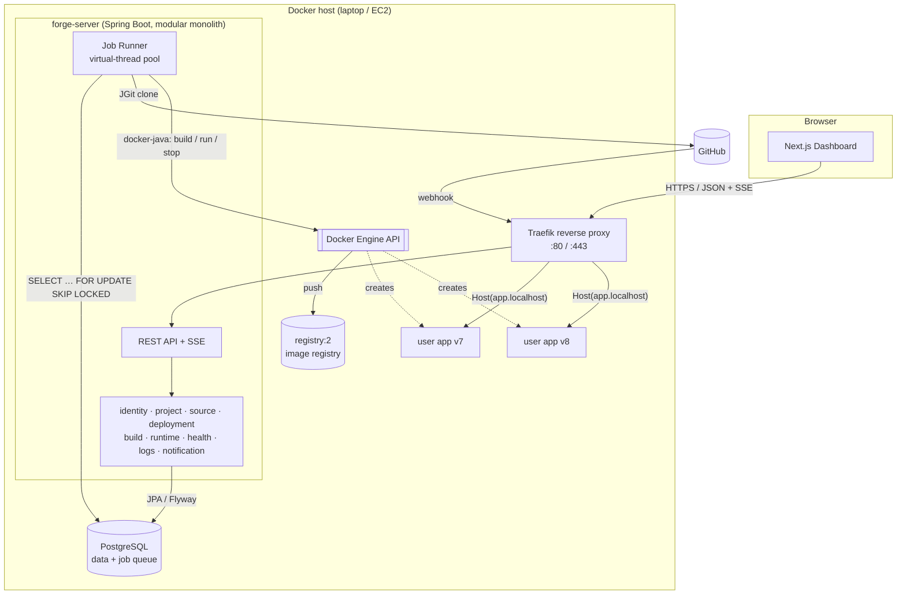
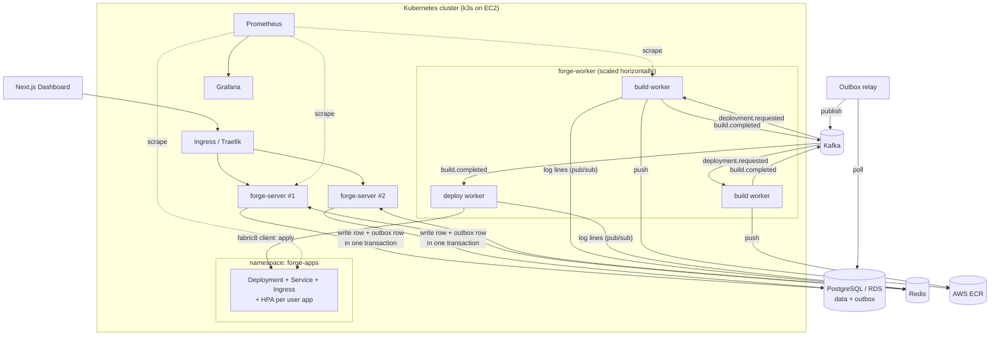
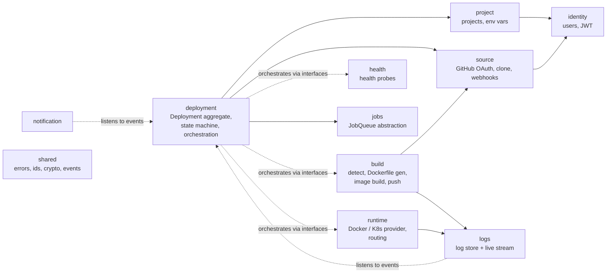
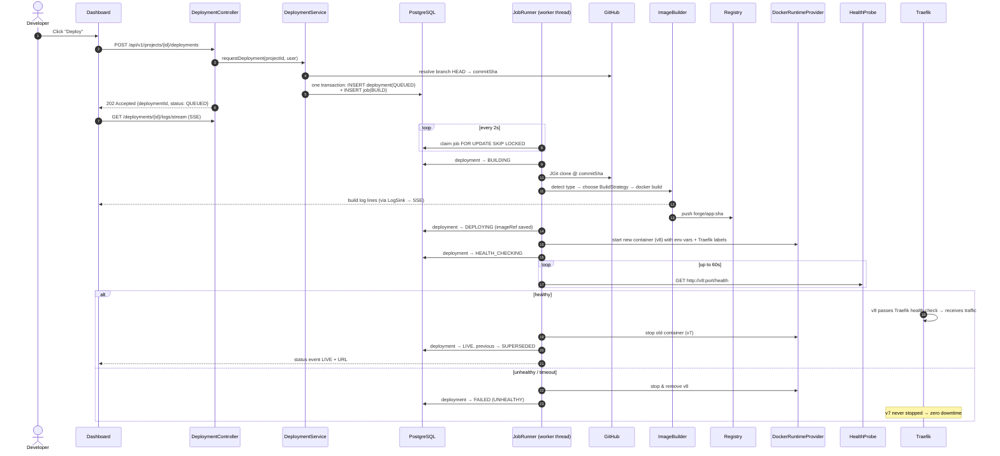
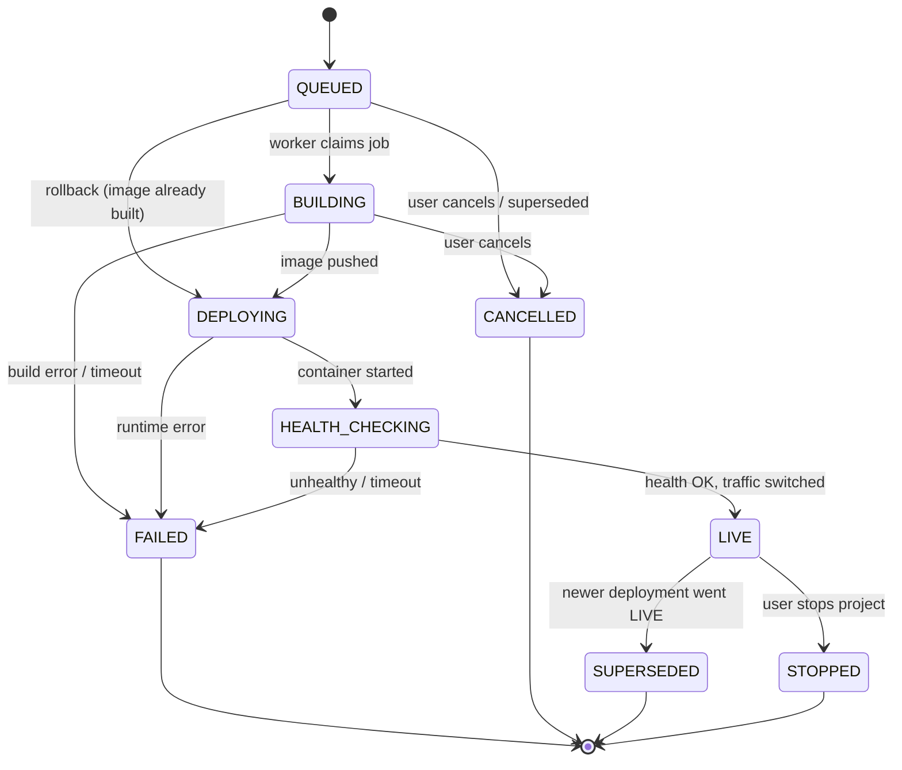
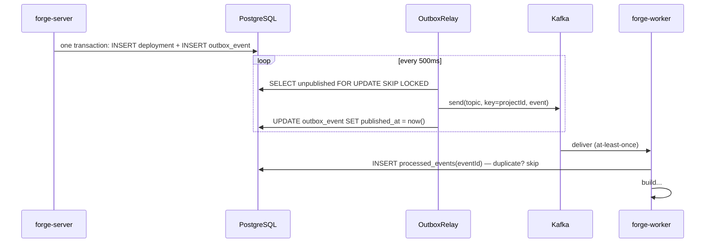

# 02 — High-Level Design (Architecture)

> Diagrams are written in Mermaid. They render on GitHub, in IntelliJ (Markdown preview), and at <https://mermaid.live> (useful for exporting PNGs for slides).

## 1. System context (C4 level 1)

Who and what interacts with Forge.



## 2. Containers — M1 (single host, Docker)

Each box is a separately running process or container.



**Key idea:** `forge-server` is the **control plane** (it decides *what* should run). Docker or Kubernetes is the **data plane** (it actually runs things). The control plane never sits in the request path of user apps. Traefik routes user traffic directly to containers.

## 3. Containers — M2 (distributed, Kubernetes, AWS)



## 4. Module map (inside `forge-server`)

The modular monolith is **package-by-feature**. A module can only use another module through its public API (an interface or domain event). It may never reach into another module's internals. This is enforced by a test (see `ModularityTest` in [07](07-engineering-standards.md)).



| Module | Owns (tables) | Exposes | Depends on |
|--------|---------------|---------|-----------|
| `identity` | users, refresh_tokens | `CurrentUser`, `UserQueryService` | shared |
| `project` | projects, environment_variables | `ProjectQueryService`, `EnvVarResolver` | identity |
| `source` | github_connections, webhook_deliveries | `SourceCodeProvider`, `GitHubClient` | identity |
| `deployment` | deployments, deployment_events | `DeploymentService`, domain events | project, source, jobs |
| `build` | — | `ImageBuilder` (used by the build job handler) | source, logs |
| `runtime` | runtime_instances | `RuntimeProvider` | logs |
| `health` | — | `HealthProbe` | — |
| `logs` | log_lines | `LogSink`, `LogStreamService` | — |
| `jobs` | jobs (M1), outbox_events (M2) | `JobQueue`, `JobHandler` | — |
| `notification` | — | listeners only | deployment (events) |

## 5. The core flow, end to end: "click Deploy"

This is the single most important diagram. Learn to narrate it.



**What to say in the viva:** "The API never does slow work. It only records intent (a `QUEUED` deployment and a job) in **one transaction** and returns `202`. All slow, failure-prone work (clone, build, run) happens asynchronously in workers, and every step moves the deployment through a validated state machine."

## 6. Deployment lifecycle (state machine)



- **Rollback** is not a special state. It creates a **new** deployment with `trigger = ROLLBACK` and the old `imageRef`, and it **skips** `BUILDING` (`QUEUED → DEPLOYING`). Because of this, history is append-only and auditable.
- `FAILED` stores a `failureReason` enum: `BUILD_FAILED`, `BUILD_TIMEOUT`, `PUSH_FAILED`, `RUNTIME_ERROR`, `UNHEALTHY`, `INTERNAL_ERROR`.

## 7. Async job processing

### M1: Postgres as a queue

```sql
-- claim one job atomically; concurrent workers skip rows another worker has locked
UPDATE jobs SET status = 'RUNNING', locked_by = :workerId, locked_until = now() + interval '5 min',
                attempts = attempts + 1
WHERE id = (
    SELECT id FROM jobs
    WHERE status = 'PENDING' AND run_after <= now()
    ORDER BY created_at
    FOR UPDATE SKIP LOCKED
    LIMIT 1)
RETURNING *;
```

- **Lease:** `locked_until` acts as a visibility timeout. A long-running job extends the lease with a heartbeat every 30 s.
- **Crash recovery:** a `StaleJobReaper` (scheduled every minute) sets `RUNNING` jobs whose lease expired back to `PENDING`.
- **Retries:** on a retryable failure, `run_after = now() + base * 2^attempts` (exponential backoff). After `max_attempts` the job goes to `DEAD`, which is our dead-letter queue.
- **Why start here?** It needs zero extra infrastructure, the enqueue is **transactional** with the deployment insert (no dual-write problem), and it is easy to reason about. Its limits (polling load, a single DB, no fan-out) are exactly what motivates Kafka in M2.

### M2: Kafka plus a transactional outbox

**The dual-write problem:** if we `INSERT deployment` and then `kafka.send()`, a crash between the two leaves the system inconsistent. **The fix** is the outbox pattern:



| Topic | Key | Producer | Consumer group |
|-------|-----|----------|----------------|
| `forge.deployment.requested` | projectId | forge-server (outbox) | `build-workers` |
| `forge.build.completed` | projectId | build worker | `deploy-workers` |
| `forge.deployment.status-changed` | projectId | all | `notifications`, `log-fanout`, `ai-investigator` |
| `*.DLT` | — | Spring Kafka error handler | operator |

- **Key = projectId** gives a guarantee: all events of one project land in the same partition, so they are **processed in order**. That is how M2 enforces "one deploy per project at a time" without locks.
- **Delivery semantics:** at-least-once delivery plus idempotent consumers (the `processed_events` table) gives **effectively-once processing**.

The `JobQueue` interface stays the same. Only the implementation changes from `PostgresJobQueue` to `KafkaJobQueue`. This is the Dependency Inversion Principle in action.

## 8. Zero-downtime deploys

| Runtime | Strategy | How |
|---------|----------|-----|
| Docker (M1) | **Blue-green** | Start the new container with the same Traefik router labels plus a Traefik health check. Traefik sends it traffic only once it is healthy. Forge verifies health, then stops the old container. If the new one is unhealthy, it is removed and the old one keeps serving. |
| Kubernetes (M2) | **Rolling update** | `maxUnavailable: 0, maxSurge: 1` plus a `readinessProbe`. K8s replaces pods one at a time. Forge watches rollout status, and on failure runs `rollout undo`. |

## 9. Security design

| Threat | Mitigation |
|--------|------------|
| Stolen password DB | BCrypt (cost 12). Plaintext is never logged. |
| Stolen JWT | Short-lived access token (15 min) plus a rotating refresh token, stored hashed and revocable |
| User A reads user B's project | Ownership check in the application service on **every** query (`findByIdAndOwnerId`). Returns 404, not 403, so resources can't be enumerated. |
| Secrets leak from the DB | Env vars and GitHub tokens are encrypted with AES-256-GCM. The master key comes from an env var or AWS KMS and is never stored in the DB or git. |
| Forged webhook | Verify `X-Hub-Signature-256` (HMAC-SHA256) with a constant-time comparison. Deduplicate by `X-GitHub-Delivery`. |
| Malicious user code | Containers run with CPU and memory limits, as non-root, with no Docker socket mounted. Builds have a 10-minute timeout. User apps live on a separate network (`forge-apps`) from Postgres and Redis. *Known limitation: this is not VM-level isolation.* |
| Abuse / DoS of the API | Rate limiting per user (Redis token bucket, M2) and a cap on concurrent builds per user |

## 10. Technology decisions (ADR summary)

Each decision follows the ADR format: *context → decision → consequence.*

| # | Decision | Why | Trade-off we accept |
|---|----------|-----|---------------------|
| ADR-1 | **Modular monolith first** | One deployable is simple to run and debug. Module boundaries are enforced by tests, so extraction is cheap later. | Modules can't scale independently, until M2 extracts the workers. |
| ADR-2 | **Postgres queue (M1) → Kafka (M2)** | Transactional enqueue, no extra infra early. Kafka adds fan-out, replay, partition ordering, and horizontal consumers. | Polling cost in M1. Operating Kafka in M2. |
| ADR-3 | **docker-java over shelling out to the `docker` CLI** | Typed API, streaming logs, testable through an interface | Library learning curve |
| ADR-4 | **JGit for cloning** | Pure Java, no `git` binary needed in the container, shallow clone at an exact SHA | Slightly slower than native git |
| ADR-5 | **Traefik for routing** | Auto-discovers containers through Docker labels, so we don't write proxy config by hand. Also works as a K8s Ingress. | Another component to learn |
| ADR-6 | **Server-Sent Events for live logs** | One-way server→browser stream over plain HTTP. Simpler than WebSockets for this use case. | One-way only (which is all we need) |
| ADR-7 | **Flyway migrations** | The schema is versioned in git, and every environment is reproducible | Applied migrations must never be edited |
| ADR-8 | **Virtual threads (Java 21)** | Builds and health checks are I/O-bound, so we get thousands of cheap threads without reactive code | Watch for pinning in `synchronized` blocks |
| ADR-9 | **k3s on EC2 instead of EKS** | A real Kubernetes API at student cost (EKS control plane ≈ $73/month) | Single-node cluster, so not HA |
| ADR-10 | **fabric8 Kubernetes client** | Fluent, typed Java API for K8s resources | — |

## 11. Failure-mode table (instructors love this)

| Component fails | What the user sees | Why it is safe |
|-----------------|-------------------|----------------|
| Worker crashes mid-build | The deploy takes a bit longer | The lease expires, the job is re-queued, and another worker retries from scratch (builds are idempotent: same SHA gives the same image tag). |
| GitHub API down | Deploy request returns 503 with a clear message | Circuit breaker opens fast instead of hanging threads |
| Registry push fails | Retries, then `FAILED (PUSH_FAILED)` | Old version still live |
| New version crashes on boot | `FAILED (UNHEALTHY)` + AI explanation | Old container never stopped |
| forge-server restarts | Dashboard reconnects SSE | All state is in Postgres. User apps keep running (control plane ≠ data plane). |
| Kafka down (M2) | Deploys stay `QUEUED` longer | Outbox rows wait in Postgres. Nothing is lost. |
| Redis down (M2) | Idempotency and rate-limit degrade (fail-open), live logs fall back to DB polling | Redis holds no source-of-truth data |
| Postgres down | API returns 503 | It is the source of truth. RDS Multi-AZ is the production answer. |
