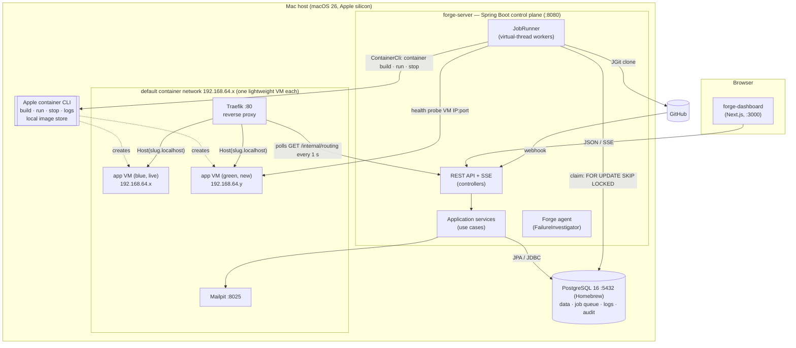
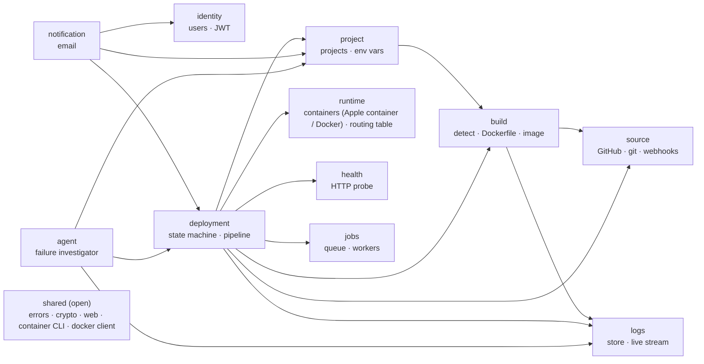
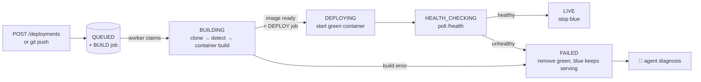

# 02 — Architecture (High-Level Design)

## 1. System context


## 2. Containers (what runs)



**Control plane vs data plane.** `forge-server` decides *what* should run and records it in Postgres. The container engine and Traefik actually run and route the apps. Visitor traffic never passes through `forge-server`, so restarting Forge doesn't take any app down.

**Container engine.** The default engine is **Apple `container`** (`forge.engine=apple`, see [D-004](DECISIONS.md)). Each app runs in its own lightweight Linux VM and is reached on that VM's IP (192.168.64.x), both by the health probe and by Traefik. Images are built with `container build` and stay in the engine's local image store, so there is no registry and no push (`forge.build.registry` is empty). Traefik is itself an Apple container started by `scripts/infra.sh up`; Apple container has no label-based discovery, so Traefik polls Forge's routing table (`GET /internal/routing`) every second. Forge builds that table from the labels on the running app containers.

The **Docker** engine (`forge.engine=docker`) is the alternative adapter for Linux and CI. There, `infra/docker-compose.yml` runs Postgres (on :5433), a local registry on :5001, Traefik and Mailpit; images are pushed to that registry when `FORGE_REGISTRY=localhost:5001` is set, apps run on the `forge-apps` network, and Traefik reads Docker labels. The pipeline code is the same for both engines.

## 3. Modules (modular monolith)

`forge-server` is one deployable split into **11 modules** (top-level packages under `com.forge`). A module may use another module **only through the types in that module's root package** (its public API). Everything in sub-packages (`api`, `application`, `domain`, `infrastructure`) is internal. `ArchitectureTest` enforces this with Spring Modulith and fails the build on any violation.



The graph has **no cycles**: dependencies point from orchestration (`deployment`) down to capabilities (`build`, `runtime`, `logs` …). Modules that only need to *react* (`notification`, `agent`) listen to the `DeploymentStatusChanged` event, so `deployment` does not know they exist.

| Module | Public API (root package) | Owns tables |
|--------|---------------------------|-------------|
| identity | `UserLookup`, `UserSummary` | users, refresh_tokens |
| project | `ProjectCatalog`, `ProjectSnapshot`, `ProjectDeleting` | projects, environment_variables |
| source | `SourceCodeProvider`, `GitHubAccounts`, `GitRepository`, `CommitInfo`, `GitPushReceived` | github_connections, webhook_deliveries |
| build | `BuildService`, `BuildRequest`, `BuildResult`, `BuildType`, `BuildFailedException` | — |
| runtime | `RuntimeProvider`, `ContainerSpec`, `RunningInstance` (plus `GET /internal/routing` for Traefik) | — |
| health | `HealthProbe`, `HealthResult` | — |
| logs | `LogSink`, `LogReader`, `LogStreams`, `LogLine`, `LogSource` | log_lines |
| jobs | `JobQueue`, `JobHandler`, `AbstractJobHandler`, `Job`, `JobType`, `JobPayload`, `JobPostponedException` | jobs |
| deployment | `DeploymentStatus`, `DeploymentStatusChanged`, `DeploymentQueries`, `DeploymentView`, `FailureReason`, `DeploymentTrigger` | deployments, deployment_events, runtime_instances |
| notification | — (listener only) | — |
| agent | — (listener + its own API) | deployment_insights |

### Layers inside a module

```
api            → controllers + request/response records (HTTP only)
application    → use-case services, @Transactional boundaries, event listeners
domain         → entities, value objects, domain rules (no web, no container engine, no JGit)
infrastructure → adapters: Spring Data repositories, the container engine (ContainerCli / docker-java), JGit, HTTP clients
```

`api → application → domain ← infrastructure`. ArchitectureTest checks that the domain never depends on web or adapter code, that controllers never touch repositories, and that only adapters import docker-java or JGit.

## 4. The deployment pipeline at a glance



Two jobs (BUILD, then DEPLOY) instead of one means a rollback can skip the BUILD job, and a crash during deploy doesn't redo a 3-minute build.

## 5. Why these technologies (decision log)

| # | Decision | Reason | Trade-off accepted |
|---|----------|--------|--------------------|
| 1 | **Modular monolith** | One deployable is simple to run, debug and demo. Boundaries are still enforced by tests, so a module could be extracted later. | Modules cannot be scaled independently |
| 2 | **Postgres as the job queue** | Enqueue happens in the **same transaction** as the deployment insert (no dual-write problem). `SKIP LOCKED` gives safe concurrent workers. No extra infrastructure. | Polling. Throughput is bounded by one DB (fine for this scale; Kafka is future work). |
| 3 | **Java 21 virtual threads** | Builds and health checks are I/O-bound. Virtual threads give one thread per job without a reactive rewrite. | — |
| 4 | **Apple container** as the default engine, **Docker** as the alternative, both behind `RuntimeProvider` and `ImageBuilder` ([D-004](DECISIONS.md)) | Each app gets its own VM, and the engine runs natively on the Mac. Apple container has only a command line, so `ContainerCli` runs it with arguments as a list (never a shell). The Docker adapters use docker-java (typed API, streaming output). | Apple container is macOS-only (Apple silicon, macOS 26+), reports no exit codes, and needs at least 200 MiB per container |
| 5 | **JGit** | Pure Java, so no git binary in the server image. Shallow clone of an exact commit. | Slower than native git on huge repos |
| 6 | **Traefik** | Polls Forge's routing table (HTTP provider, every second) on Apple container, or reads Docker labels on the Docker engine, so Forge never writes proxy config files. Built-in health checks and a retry middleware. | One more component |
| 7 | **Server-Sent Events** for logs | One-way server→browser stream over plain HTTP, with auto-reconnect and resume (`Last-Event-ID`) built into browsers | One-way only (all we need) |
| 8 | **Flyway** | Schema versioned in git and identical everywhere. Hibernate only validates. | Applied migrations must never be edited |
| 9 | **JWT + rotating refresh tokens** | Stateless API (any instance can verify). Refresh rotation limits stolen-token damage. | Access tokens can't be revoked before their 15-minute expiry |
| 10 | **Rules first, LLM optional** for the agent | Works offline and deterministically in the demo. The LLM improves answers when available, and any LLM error falls back to rules. | Rules only know the failure patterns we wrote down |
| 11 | **Spring Boot 3.5 (not 4.x)** | Matches the locked course scope and the mature ecosystem (springdoc, Modulith 1.4) | Boot 3.5 is near the end of its open-source support window |

## 6. Security architecture

| Threat | Mitigation | Code |
|--------|------------|------|
| Password database leak | BCrypt cost 12 | `SecurityConfig.passwordEncoder` |
| Stolen refresh token | Stored as SHA-256 only. Rotated on every use. Replaying a used token revokes **all** sessions of that user. | `AuthService.refresh` |
| Account enumeration | Same 401 message, and the same BCrypt timing, for unknown email and wrong password | `AuthService.login` (dummy hash) |
| Reading another user's data | Ownership is part of every query. Answers 404, never 403. | `ProjectRepository.findOwned`, `DeploymentQueryService.getOwned` |
| Secrets in the database | AES-256-GCM (random IV, tamper detection). The key comes only from the environment. | `EncryptionService` |
| Forged webhooks | HMAC-SHA256 with constant-time compare, plus delivery-id de-duplication | `WebhookService.verifySignature` |
| Reading the routing table | `GET /internal/routing` needs the shared `X-Forge-Routing-Token` header (constant-time compare); 401 without it | `RoutingController` |
| OAuth CSRF | Single-use, 10-minute `state` | `OAuthStateStore` |
| Secrets leaking to the LLM | Env-var values are redacted from logs before the agent reads them | `SecretRedactor` |
| Malicious user code | Apple container: each app in its own lightweight VM, memory and CPU limits, all Linux capabilities dropped, a build timeout. Docker engine: memory and CPU limits, 256-process limit, `no-new-privileges`, a separate network from the DB, a build timeout (*not VM-level isolation*). | `AppleContainerRuntimeProvider`, `DockerRuntimeProvider` |
| Path traversal via repo settings | `rootDir`, `repoName` and `slug` are validated in value objects. The context dir must stay inside the workspace. | `BuildSettings`, `RepoRef`, `DefaultBuildService` |

## 7. Failure modes

| What fails | User impact | Why the system stays correct |
|------------|-------------|------------------------------|
| Worker crashes mid-build | Deployment takes longer | The lease expires, the reaper re-queues, and the job retries (`BUILDING` is accepted on retry). Same commit gives the same image tag. |
| New version crashes or listens on the wrong port | `FAILED (UNHEALTHY)` + diagnosis | Green is removed. Blue is never touched. |
| Container engine briefly unavailable | Slower deploy | `ExternalServiceException` is retryable: backoff 10 s → 20 s → 40 s, then dead-lettered → FAILED |
| Two deploys of one project at once | Second one waits | Postponed via `JobPostponedException`, and the partial unique index is the last line of defence |
| GitHub retries a webhook | Nothing | `webhook_deliveries` primary key |
| User cancels during a build | Build finishes, then the image is discarded | `completeBuild` sees `CANCELLED` and does nothing |
| forge-server restarts | Dashboard reconnects | State is in Postgres. Apps keep running (control plane ≠ data plane). |
| Mail server down | No email | Notifications are async and after commit, and a failure is only logged |
| LLM API down or slow | Diagnosis comes from rules | `ClaudeDiagnosisEngine` returns empty on any error |

## 8. How it would scale (future work, not built)

| Bottleneck | Next step |
|------------|-----------|
| One Postgres as the queue | Kafka topic per job type, transactional outbox, idempotent consumers |
| Live logs held in one JVM's memory | Redis pub/sub so any API replica can serve any stream |
| Builds compete with the API for CPU | Extract `jobs` + `build` + `deployment` handlers into a separate `forge-worker` deployable (module boundaries already allow it) |
| A single container host | A Kubernetes `RuntimeProvider` (Deployment + Service + Ingress, rolling update, HPA). The pipeline code stays unchanged, as it did when the engine moved from Docker to Apple container. |
| Container isolation on Linux | gVisor or Firecracker microVMs for untrusted builds on the Docker engine (Apple container already isolates each app in a VM) |
