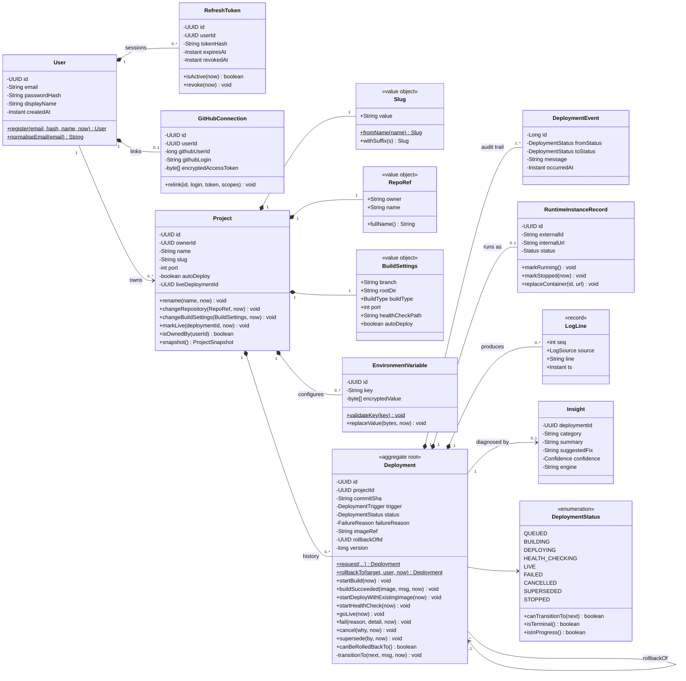
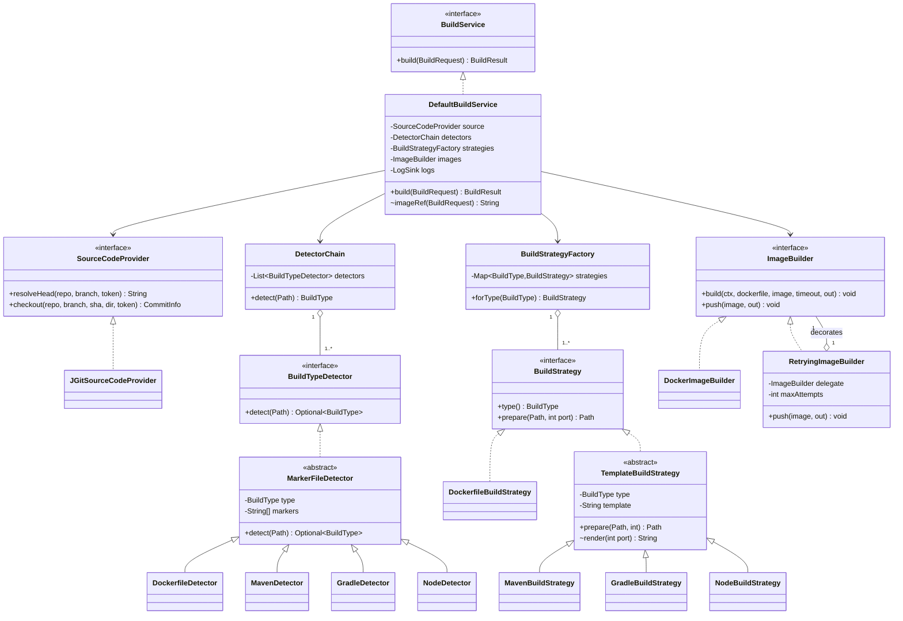
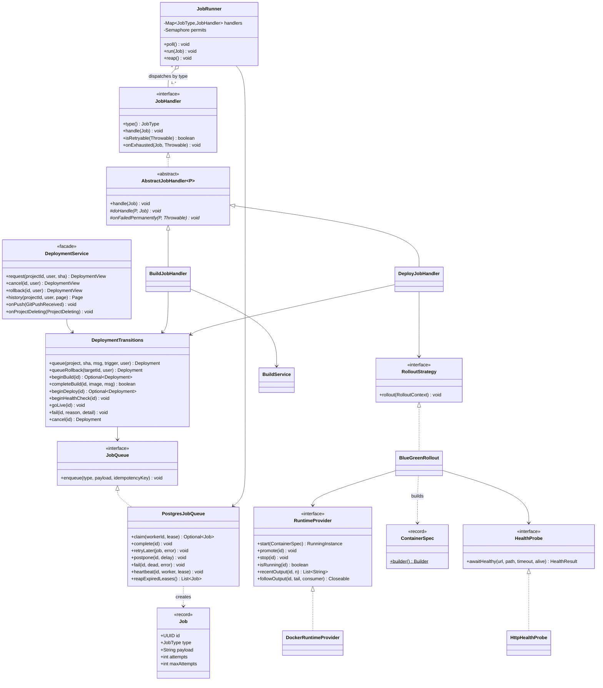
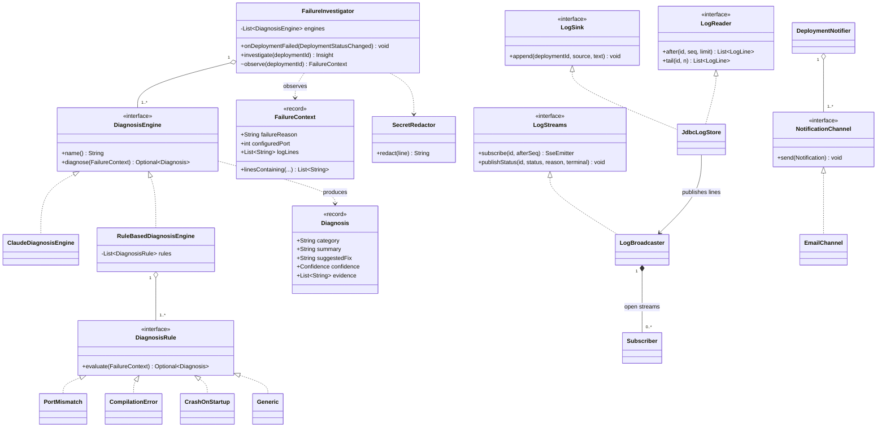

# 03 — Class Design, OOP, SOLID and Design Patterns

> Rubric items 2–5. Every class named here exists in `forge-server/src/main/java/com/forge/…`.

**Relationship notation used in the diagrams**

| Symbol | Meaning | Example in Forge |
|--------|---------|------------------|
| `A *-- B` | **Composition**: B cannot exist without A and is deleted with it | Project ◆— EnvironmentVariable |
| `A o-- B` | **Aggregation**: A holds a collection of B, but B lives on its own | DetectorChain ◇— BuildTypeDetector |
| `A --> B` | **Association**: A references B | Deployment → Project (by id) |
| `A <\|-- B` | **Inheritance**: B extends A | AbstractJobHandler ◁— BuildJobHandler |
| `A <\|.. B` | **Realisation**: B implements interface A | RuntimeProvider ◁┈ DockerRuntimeProvider |
| `A ..> B` | **Dependency**: A uses B transiently | BlueGreenRollout ┈> ContainerSpec |

Numbers on the ends are multiplicities (`1`, `0..1`, `0..*`, `1..*`).

## 1. Domain model (entities and value objects)

Why composition here: deleting a project deletes its env vars and deployment history (`ON DELETE CASCADE` in [06](06-database-schema.md)), and an audit event or log line means nothing without its deployment. `User → Project` is a plain association, because a project only stores `ownerId`.

## 2. Build subsystem

## 3. Deployment pipeline, runtime and jobs

## 4. Agent, logs and notifications

(Rule list abbreviated: there are 12 rules in `DiagnosisRules`.)

## 5. Object-oriented design

| Principle | Where | Explanation |
|-----------|-------|-------------|
| **Encapsulation** | `Deployment` has **no setters**. The status only changes through `startBuild()`, `goLive()` and the like, which all funnel into the private `transitionTo()`. `EnvironmentVariable` only ever holds ciphertext. `Project` validates every change. | The object protects its own invariants; nobody can set `status = LIVE` from outside. |
| **Abstraction** | `RuntimeProvider`, `BuildService`, `SourceCodeProvider`, `HealthProbe`, `JobQueue`, `LogSink` | Callers see *what* (start a container, build an image), never *how* (docker-java, JGit, SQL). |
| **Inheritance** | `AbstractJobHandler` → `BuildJobHandler`, `DeployJobHandler`. `TemplateBuildStrategy` → `MavenBuildStrategy`, `GradleBuildStrategy`, `NodeBuildStrategy`. `MarkerFileDetector` → 4 detectors. `ForgeException` → `NotFoundException`, `ValidationException`, `ExternalServiceException`, `IllegalStateTransitionException`. `Deployment` → `AbstractAggregateRoot`. | Shared behaviour is written once in the parent. |
| **Polymorphism** | `DetectorChain` iterates `List<BuildTypeDetector>`. `JobRunner` calls `handler.handle(job)` without knowing which handler. `FailureInvestigator` asks each `DiagnosisEngine`. `GlobalExceptionHandler` maps any `ForgeException` by its `ErrorCode`. | One call site, many behaviours chosen at runtime. |
| **Interfaces vs abstract classes** | Interfaces for **capabilities and ports** (no shared state). Abstract classes only where subclasses **share code** (`AbstractJobHandler` holds the metrics/MDC skeleton; `TemplateBuildStrategy` holds template loading). | Prefer interfaces; use inheritance only to remove real duplication. |

## 6. SOLID — where each principle is applied

| Principle | Concrete example | What it buys us |
|-----------|------------------|-----------------|
| **S** — Single Responsibility | `AuthController` only does HTTP. `AuthService` holds the use cases. `JwtService` only signs and verifies. `EncryptionService` only encrypts. `DeploymentTransitions` only changes state. `BlueGreenRollout` only orchestrates a rollout. `HttpHealthProbe` only probes. | Each class has one reason to change and is small enough to explain in a minute. |
| **O** — Open/Closed | New stack (e.g. Python) = one new `BuildTypeDetector` + one `TemplateBuildStrategy` subclass + a template. New failure pattern = one new `DiagnosisRule`. New notification channel = one `NotificationChannel` bean. Push retries were added as a **decorator** without editing `DockerImageBuilder`. | Features are added by adding classes, not by editing tested ones. |
| **L** — Liskov Substitution | Any `RuntimeProvider` can replace `DockerRuntimeProvider` in `BlueGreenRollout`. `RetryingImageBuilder` can stand wherever an `ImageBuilder` is expected. Tests substitute mocks for `BuildService`, `RuntimeProvider` and `HealthProbe` and the pipeline behaves identically. | The pipeline is correct for every implementation that honours the contract. |
| **I** — Interface Segregation | Logs are split into `LogSink` (write), `LogReader` (read) and `LogStreams` (live). The builder only receives `LogSink`. `ProjectCatalog` gives other modules exactly what they need, not the whole `ProjectService`. | No class depends on methods it doesn't use. |
| **D** — Dependency Inversion | `deployment` depends on the `BuildService`, `RuntimeProvider`, `HealthProbe`, `JobQueue` and `SourceCodeProvider` **interfaces**. The Docker, JGit and Postgres adapters live in `infrastructure` packages and are injected by Spring. `ArchitectureTest` proves only adapters import Docker or JGit. | High-level policy (the pipeline) doesn't depend on low-level details (Docker), so the runtime could become Kubernetes. |

## 7. Design patterns (with justification)

### Creational

| Pattern | Where | Why this pattern |
|---------|-------|------------------|
| **Factory Method** | `Deployment.request(...)`, `Deployment.rollbackTo(...)`, `User.register(...)`, `Slug.fromName(...)` | Named constructors make intent explicit and enforce creation rules (a rollback copies the image and can only target a deployment that went live). |
| **Factory** (registry) | `BuildStrategyFactory.forType(BuildType)`. The `JobRunner` handler registry (`EnumMap<JobType, JobHandler>`). | Picks the right implementation by key, with no `if/else` chain. Validated at startup (duplicate handler fails fast). |
| **Builder** | `ContainerSpec.builder()…build()` | A container spec has 9 fields, several optional. A builder keeps call sites readable, and the record stays immutable. |
| **Singleton** | Every Spring bean (`EncryptionService`, `JwtService`, the shared `DockerClient`, `LogBroadcaster` …) is a single instance managed by the container. | One shared, stateless (or thread-safe) instance. No hand-written `getInstance()`, so it stays testable. |

### Structural

| Pattern | Where | Why this pattern |
|---------|-------|------------------|
| **Adapter** | `JGitSourceCodeProvider` (JGit → `SourceCodeProvider`), `DockerImageBuilder` and `DockerRuntimeProvider` (docker-java → our ports), `GitHubApiClient` (REST → typed records), `HttpHealthProbe` | Third-party APIs are translated at the edge, so the domain never sees them and they can be swapped or mocked. |
| **Decorator** | `RetryingImageBuilder` wraps an `ImageBuilder` and adds push retries | Adds behaviour without modifying or subclassing the Docker adapter, using the same interface. |
| **Facade** | `DeploymentService` (request, cancel, rollback over transitions, the source provider and queries). `BuildService` hides clone → detect → strategy → build → push. | Controllers and handlers call one simple method instead of coordinating five collaborators. |
| **Proxy** | Spring wraps beans in proxies for `@Transactional` and `@Async` (`DeploymentTransitions`, `FailureInvestigator`) | Cross-cutting concerns (transactions, threading) without code in each method. |

### Behavioural

| Pattern | Where | Why this pattern |
|---------|-------|------------------|
| **State** | `DeploymentStatus` (transition table) + `Deployment.transitionTo()` | The lifecycle has strict legal moves. Centralising them makes illegal states impossible and testable (`DeploymentStatusTest` checks all 81 pairs). |
| **Strategy** | `BuildStrategy`, `RolloutStrategy` (`BlueGreenRollout`), `DiagnosisEngine`, `NotificationChannel`, `RuntimeProvider` | Interchangeable algorithms behind one interface, chosen by type or configuration. |
| **Template Method** | `AbstractJobHandler.handle()` is `final`: decode → MDC → timer → `doHandle()`. `TemplateBuildStrategy.prepare()` is `final`: render → write. | A fixed skeleton with variable steps, so every job gets logging and metrics for free. |
| **Chain of Responsibility** | `DetectorChain` (Dockerfile → Maven → Gradle → Node). Diagnosis: LLM engine → rule engine → 12 ordered rules, with a generic fallback last. | Try handlers in priority order until one answers. Adding a handler doesn't change the others. |
| **Observer** | `DeploymentStatusChanged` → `DeploymentEventListeners` (audit, live stream, metrics), `DeploymentNotifier`, `FailureInvestigator`. `LogBroadcaster` → `Subscriber`s (open browser streams). | The deployment module announces changes without knowing who listens. Notification and the agent are fully decoupled. |
| **Command** | `Job` rows (BUILD / DEPLOY) with `BuildJobPayload` / `DeployJobPayload` | A request becomes data that can be queued, retried, postponed, dead-lettered and audited. |

### Architectural and enterprise patterns

Repository (Spring Data), Aggregate Root plus domain events (`Deployment extends AbstractAggregateRoot`), Value Object (`Slug`, `RepoRef`, `BuildSettings`), Unit of Work (`DeploymentTransitions`, one short transaction per change), Optimistic Locking (`@Version`), Idempotent Receiver (webhook deliveries, job idempotency keys), Lease and Heartbeat (job queue), Ports and Adapters (hexagonal), Modular Monolith.

## 8. Concurrency design

| Concern | Solution | Code |
|---------|----------|------|
| Many slow, I/O-bound jobs | One virtual thread per job | `JobRunner.workers` |
| Back-pressure | `Semaphore(maxConcurrent)` bounds jobs per instance | `JobRunner.permits` |
| Two workers, one job | `UPDATE … WHERE id = (SELECT … FOR UPDATE SKIP LOCKED LIMIT 1)` | `PostgresJobQueue.claim` |
| A worker dies | Lease (`locked_until`), heartbeat every lease/3, reaper re-queues | `JobRunner.reap` |
| Two updates to one deployment | `@Version` optimistic lock. Conflicts are retryable. | `Deployment.version`, `AbstractJobHandler.isRetryable` |
| Two deployments of one project | App check → `JobPostponedException`. DB partial unique index as the last line of defence. | `DeploymentTransitions.waitIfProjectBusy`, `ux_deployments_one_active` |
| Concurrent writes to one browser stream | `synchronized` per `Subscriber`, `CopyOnWriteArrayList` registry | `LogBroadcaster` |
| Log sequence numbers | Per-deployment `AtomicInteger` seeded from the DB | `JdbcLogStore.counter` |
