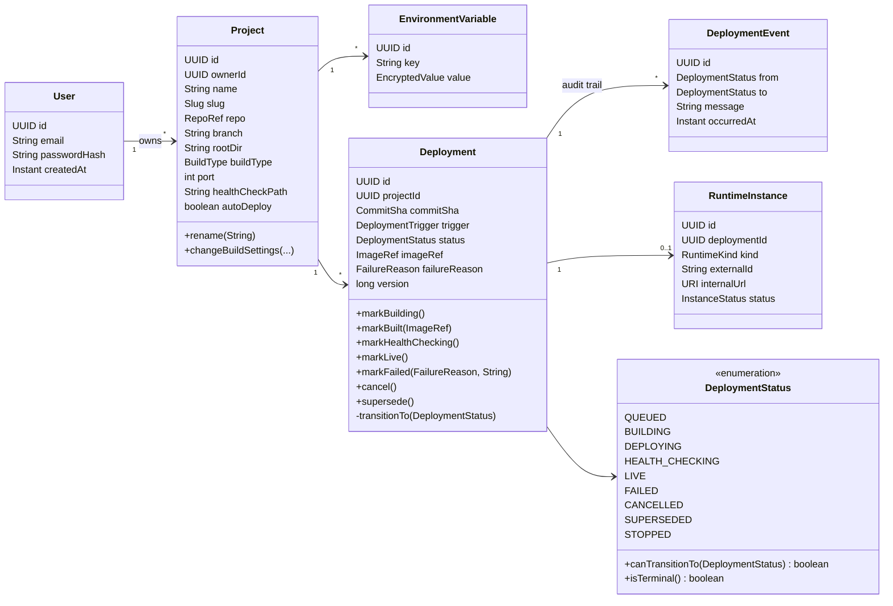
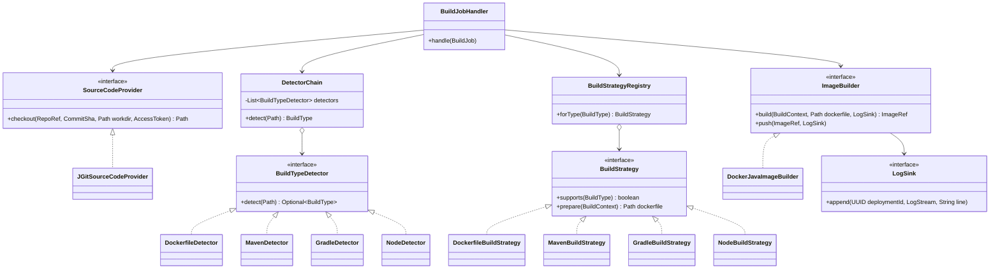
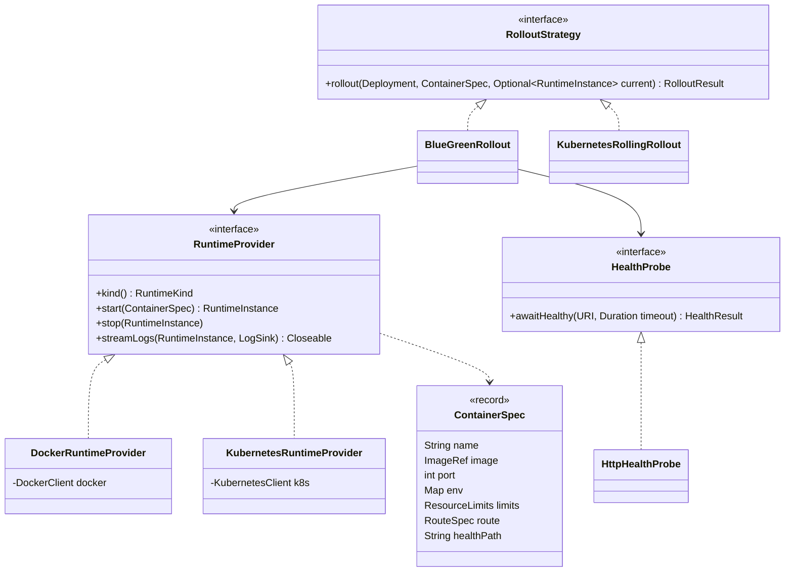
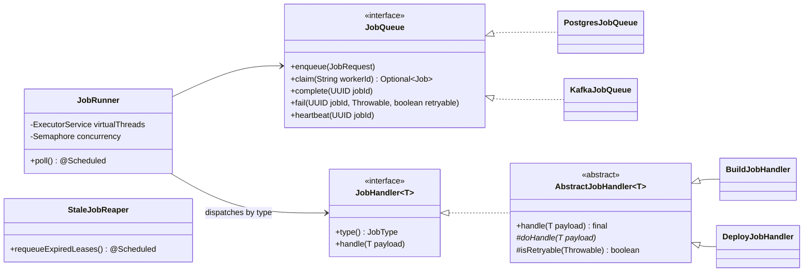

# 03 — Low-Level Design (Classes, Patterns, SOLID)

## 1. Repository layout

```
forge/                                  ← git root (this folder)
├── pom.xml                             ← Maven parent (Java 21, dependency versions)
├── mvnw, .mvn/                         ← Maven wrapper (no global Maven install needed)
├── forge-server/                       ← Spring Boot control plane (modular monolith)
│   └── src/main/java/com/forge/
│       ├── ForgeApplication.java
│       ├── shared/                     ← cross-cutting: errors, ids, crypto, base events
│       ├── identity/                   ← users, JWT, refresh tokens
│       ├── project/                    ← projects, env vars
│       ├── source/                     ← GitHub OAuth, clone, webhooks
│       ├── deployment/                 ← Deployment aggregate + state machine + orchestration
│       ├── build/                      ← type detection, Dockerfile generation, image build
│       ├── runtime/                    ← RuntimeProvider (Docker, K8s), routing
│       ├── health/                     ← health probes
│       ├── logs/                       ← log persistence + SSE streaming
│       ├── notification/               ← email / Discord on events
│       └── jobs/                       ← JobQueue, JobRunner, JobHandler
│   └── src/main/resources/
│       ├── application.yml
│       └── db/migration/V1__init.sql … ← Flyway
├── forge-worker/                       ← (M2) extracted build/deploy workers
├── forge-dashboard/                    ← Next.js UI (only non-Java code)
├── infra/
│   ├── docker-compose.yml              ← postgres, registry, traefik, mailpit (+kafka, redis, prometheus, grafana in M2)
│   ├── traefik/  prometheus/  grafana/
│   └── k8s/                            ← manifests for M2
├── sample-apps/hello-spring, hello-node
└── docs/
```

### Layers inside every module (hexagonal-lite)

```
deployment/
├── api/             ← @RestController, request/response DTOs (records). HTTP only, no business logic.
├── application/     ← use-case services (@Service, @Transactional). Orchestrate domain + ports.
├── domain/          ← entities, value objects, enums, domain events, PORT interfaces. No Spring web/JPA logic.
└── infrastructure/  ← adapters: JPA repositories, docker-java, JGit, HTTP clients. Implement the ports.
```

**Dependency rule:** `api → application → domain ← infrastructure`. The domain depends on nothing. Infrastructure depends on the domain (it implements its interfaces). This *is* the Dependency Inversion Principle applied at the architectural level.

## 2. Core domain model



**Value objects** (Java `record`s, immutable, validated in the constructor): `Slug`, `RepoRef(owner, name)`, `CommitSha`, `ImageRef(registry, repository, tag)`, `EncryptedValue`. They make illegal states unrepresentable. For example, a `CommitSha` is always 40 hex characters.

### State machine in code (State pattern via a rich enum)

```java
public enum DeploymentStatus {
    QUEUED, BUILDING, DEPLOYING, HEALTH_CHECKING, LIVE, FAILED, CANCELLED, SUPERSEDED, STOPPED;

    private static final Map<DeploymentStatus, Set<DeploymentStatus>> ALLOWED = Map.of(
        QUEUED,          EnumSet.of(BUILDING, DEPLOYING, CANCELLED),
        BUILDING,        EnumSet.of(DEPLOYING, FAILED, CANCELLED),
        DEPLOYING,       EnumSet.of(HEALTH_CHECKING, FAILED),
        HEALTH_CHECKING, EnumSet.of(LIVE, FAILED),
        LIVE,            EnumSet.of(SUPERSEDED, STOPPED),
        FAILED,          EnumSet.noneOf(DeploymentStatus.class),
        CANCELLED,       EnumSet.noneOf(DeploymentStatus.class),
        SUPERSEDED,      EnumSet.noneOf(DeploymentStatus.class),
        STOPPED,         EnumSet.noneOf(DeploymentStatus.class));

    public boolean canTransitionTo(DeploymentStatus next) {
        return ALLOWED.get(this).contains(next);
    }

    public boolean isTerminal() {
        return ALLOWED.get(this).isEmpty();
    }
}
```

```java
// Inside the Deployment aggregate: the ONLY way status can change
private void transitionTo(DeploymentStatus next, String message) {
    if (!status.canTransitionTo(next)) {
        throw new IllegalStateTransitionException(id, status, next);
    }
    var previous = this.status;
    this.status = next;
    registerEvent(new DeploymentStatusChanged(id, projectId, previous, next, message, Instant.now()));
}
```

There are no public setters. Every status change goes through `transitionTo`. That is **encapsulation**: the object protects its own invariants. The `@Version long version` field adds **optimistic locking**, so two workers can't both move the same deployment.

## 3. Build subsystem



- **Chain of Responsibility:** detectors are ordered with `@Order`. `DockerfileDetector` is first, so a user's own Dockerfile always wins.
- **Strategy:** each `BuildStrategy` knows how to produce a Dockerfile for its type. `MavenBuildStrategy` renders a template from `resources/build-templates/maven.Dockerfile`.
- **Open/Closed:** adding Python support means one new detector, one new strategy, and one template. **No existing class changes.** Spring injects `List<BuildStrategy>` automatically.

## 4. Runtime subsystem



- `forge.runtime.kind=docker|kubernetes` in `application.yml` selects the provider through `@ConditionalOnProperty`. Switching from Docker to K8s in M2 is a **config change**, not a rewrite. That's the Liskov Substitution and Dependency Inversion principles.
- `ContainerSpec` is built with a **Builder** (`ContainerSpec.builder()...build()`) because it has many optional fields.

### Blue-green in pseudo-Java

```java
public RolloutResult rollout(Deployment d, ContainerSpec spec, Optional<RuntimeInstance> current) {
    RuntimeInstance next = runtime.start(spec);                       // green
    d.markHealthChecking();
    HealthResult health = probe.awaitHealthy(next.internalUrl(), Duration.ofSeconds(60));
    if (!health.healthy()) {
        runtime.stop(next);                                           // discard green
        return RolloutResult.failed(FailureReason.UNHEALTHY, health.detail());
    }
    current.ifPresent(runtime::stop);                                 // retire blue
    return RolloutResult.live(next);
}
```

## 5. Jobs subsystem



`AbstractJobHandler.handle()` is a **Template Method**. It is `final` and fixed: set MDC (`deploymentId`, `jobId`) → start a timer metric → `doHandle()` → record success or failure → clear MDC. Subclasses fill in only `doHandle()`.

```java
public abstract class AbstractJobHandler<T extends JobPayload> implements JobHandler<T> {
    @Override
    public final void handle(T payload) {
        try (var ignored = MdcScope.of("deploymentId", payload.deploymentId())) {
            Timer.Sample sample = Timer.start(meterRegistry);
            try {
                doHandle(payload);
                sample.stop(timer(type(), "success"));
            } catch (Exception e) {
                sample.stop(timer(type(), "failure"));
                throw e;
            }
        }
    }

    protected abstract void doHandle(T payload);
}
```

### Domain events (sealed hierarchy, Java 21)

```java
public sealed interface DeploymentDomainEvent
        permits DeploymentRequested, DeploymentStatusChanged, BuildCompleted, DeploymentFailed {
    UUID deploymentId();
    UUID projectId();
    Instant occurredAt();
}

public record DeploymentStatusChanged(UUID deploymentId, UUID projectId,
        DeploymentStatus from, DeploymentStatus to, String message, Instant occurredAt)
        implements DeploymentDomainEvent {}
```

Listeners use `@TransactionalEventListener(phase = AFTER_COMMIT)`. A notification is **never** sent for a transaction that rolled back. Because the hierarchy is `sealed`, a `switch` over events is checked for exhaustiveness by the compiler.

## 6. Design patterns: where each one is, and why

| Pattern | Where | Why it is the right tool here |
|---------|-------|-------------------------------|
| **State** | `DeploymentStatus` + `Deployment.transitionTo` | The lifecycle has strict legal transitions. They are centralised in one place and impossible to bypass. |
| **Strategy** | `BuildStrategy`, `RuntimeProvider`, `RolloutStrategy` | The same operation has interchangeable algorithms, chosen at runtime or by config |
| **Chain of Responsibility** | `DetectorChain` of `BuildTypeDetector`s | Try handlers in priority order until one matches |
| **Template Method** | `AbstractJobHandler` | Fixed skeleton (logging, metrics, error handling) with variable steps |
| **Factory / Registry** | `BuildStrategyRegistry`, `JobHandlerRegistry` | Look up the right implementation by key without `if/else` chains |
| **Builder** | `ContainerSpec`, `BuildContext` | Immutable objects with many optional fields |
| **Adapter** | `JGitSourceCodeProvider`, `DockerJavaImageBuilder`, `GitHubApiClient` | Wrap third-party APIs behind our own interfaces, so the domain never imports `com.github.dockerjava` |
| **Facade** | `DeploymentOrchestrator` | One simple entry point over build + runtime + health + logs |
| **Observer / Pub-Sub** | Spring events (M1), Kafka topics (M2) | Notification, logs, and metrics react to deployment changes without the deployment module knowing they exist |
| **Decorator / Proxy** | Resilience4j `@Retry`/`@CircuitBreaker` on `GitHubApiClient`, `@Cacheable` repo list | Add cross-cutting behaviour without changing the class |
| **Command** | `Job` rows / Kafka messages (`BuildJob`, `DeployJob`) | A request is turned into an object that can be queued, retried, and logged |
| **Repository** | Spring Data repositories | Persistence hidden behind a collection-like interface |
| **Singleton** | Spring beans (default scope) | One shared, stateless instance per service |
| **Transactional Outbox** (distributed) | `outbox_events` + `OutboxRelay` | Atomic "save state + publish event" |
| **Saga (orchestrated)** | `DeploymentOrchestrator` with compensation (stop the green container on failure) | A multi-step process across services, with no distributed transaction |
| **Idempotent Consumer** | `processed_events` table | At-least-once delivery without duplicate side effects |
| **Circuit Breaker / Retry with backoff** | Resilience4j | Fail fast and recover from transient faults |

## 7. SOLID: concrete examples you can point at

| Principle | Example in Forge |
|-----------|------------------|
| **S**ingle Responsibility | `DeploymentController` handles only HTTP. `DeploymentService` handles only use-case logic. `HttpHealthProbe` only probes. `EncryptionService` only encrypts. |
| **O**pen/Closed | New language support = a new `BuildStrategy` bean. New runtime = a new `RuntimeProvider`. No edits to existing classes. |
| **L**iskov Substitution | `DockerRuntimeProvider` and `KubernetesRuntimeProvider` are interchangeable. `BlueGreenRollout` works with any provider that honours the contract (start returns a reachable instance). |
| **I**nterface Segregation | `LogSink` (write) is separate from `LogStreamService` (read/subscribe). Builders only need to write. `JobQueue` users never see Kafka admin APIs. |
| **D**ependency Inversion | `deployment.application` depends on `JobQueue`, `ImageBuilder`, and `RuntimeProvider` *interfaces* defined in the domain. Postgres, Kafka, Docker, and K8s live in `infrastructure` and are injected by Spring. |

## 8. OOP pillars: where they show up

| Pillar | Example |
|--------|---------|
| Encapsulation | `Deployment` has no setters, and its status changes only through intent-revealing methods |
| Abstraction | `RuntimeProvider.start(spec)` hides whether a Docker container or a K8s Deployment is created |
| Inheritance | `AbstractJobHandler` → `BuildJobHandler`, `DeployJobHandler`. Also a `ForgeException` hierarchy. |
| Polymorphism | `List<BuildStrategy>`, where the right `prepare()` runs at runtime. Also a `switch` over a sealed event type. |

## 9. Exception hierarchy

```
ForgeException (abstract, unchecked, carries ErrorCode)
├── NotFoundException              → 404
├── ValidationException            → 400
├── ConflictException              → 409  (slug taken, deployment already in progress)
├── IllegalStateTransitionException→ 409
├── ExternalServiceException       → 502/503 (GitHub, registry, docker) — retryable
└── BuildFailedException           → recorded on the Deployment, not an HTTP error
```

A single `@RestControllerAdvice` (`GlobalExceptionHandler`) maps these to RFC 9457 `ProblemDetail` responses. Controllers never contain `try/catch`.

## 10. Concurrency model

| Concern | Solution |
|---------|----------|
| Many concurrent I/O-bound jobs | `Executors.newVirtualThreadPerTaskExecutor()` + `Semaphore(maxConcurrentBuilds)` for back-pressure |
| Two workers claiming the same job | `FOR UPDATE SKIP LOCKED` (M1), Kafka consumer-group partition assignment (M2) |
| Two workers updating the same deployment | JPA `@Version` optimistic locking |
| Two deploys of the same project at once | M1: `pg_try_advisory_xact_lock(projectId hash)` around the deploy phase. M2: Kafka key = projectId, which serialises them per partition. |
| Long builds | Heartbeat extends the lease. A hard timeout (10 min) uses `Future.get(timeout)` and then cancels the build. |
| Thread-safe live log fan-out | `ConcurrentHashMap<UUID, CopyOnWriteArrayList<SseEmitter>>` (M1), Redis pub/sub (M2) |
