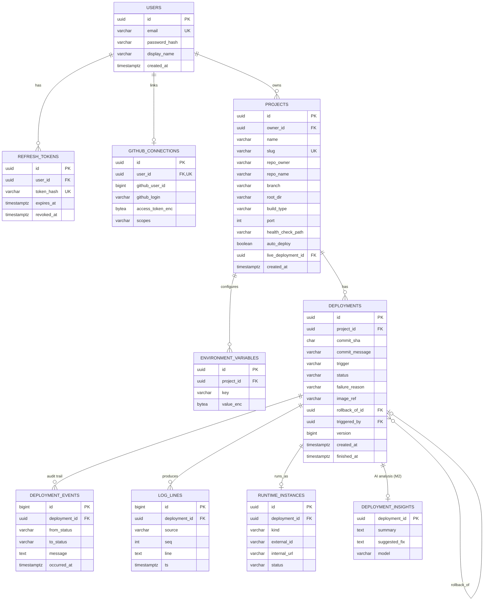

# 04 — Database Schema (PostgreSQL 16)

**Conventions**
- Primary keys are `UUID` (generated in Java with `UUID.randomUUID()`, or UUIDv7 for index locality). They are not guessable and safe to expose in URLs.
- Timestamps are `TIMESTAMPTZ`, always UTC.
- Enums are stored as `VARCHAR` with a `CHECK` constraint, not native PG enums, so adding a value is a simple migration.
- Every schema change is a new Flyway file `V<n>__<description>.sql`. **An applied migration is never edited.**
- Module ownership: a module only reads or writes its own tables (see [02 §4](02-architecture-hld.md#4-module-map-inside-forge-server)).

## 1. ER diagram



Infrastructure tables (not owned by a business module): `jobs` (M1), `webhook_deliveries`, `outbox_events` (M2), `processed_events` (M2).

## 2. DDL

### V1__identity.sql

```sql
CREATE TABLE users (
    id             UUID PRIMARY KEY,
    email          VARCHAR(320) NOT NULL,
    password_hash  VARCHAR(100) NOT NULL,
    display_name   VARCHAR(100) NOT NULL,
    created_at     TIMESTAMPTZ  NOT NULL DEFAULT now(),
    updated_at     TIMESTAMPTZ  NOT NULL DEFAULT now()
);
CREATE UNIQUE INDEX ux_users_email ON users (lower(email));      -- case-insensitive uniqueness

CREATE TABLE refresh_tokens (
    id          UUID PRIMARY KEY,
    user_id     UUID        NOT NULL REFERENCES users (id) ON DELETE CASCADE,
    token_hash  VARCHAR(64) NOT NULL UNIQUE,                     -- SHA-256 of the token, never the token itself
    expires_at  TIMESTAMPTZ NOT NULL,
    revoked_at  TIMESTAMPTZ,
    created_at  TIMESTAMPTZ NOT NULL DEFAULT now()
);
CREATE INDEX ix_refresh_tokens_user ON refresh_tokens (user_id);
```

### V2__source.sql

```sql
CREATE TABLE github_connections (
    id                UUID PRIMARY KEY,
    user_id           UUID         NOT NULL UNIQUE REFERENCES users (id) ON DELETE CASCADE,
    github_user_id    BIGINT       NOT NULL,
    github_login      VARCHAR(100) NOT NULL,
    access_token_enc  BYTEA        NOT NULL,                     -- AES-256-GCM: iv || ciphertext || tag
    scopes            VARCHAR(255) NOT NULL,
    created_at        TIMESTAMPTZ  NOT NULL DEFAULT now()
);

CREATE TABLE webhook_deliveries (
    delivery_id  VARCHAR(64) PRIMARY KEY,                       -- X-GitHub-Delivery → dedup key
    event_type   VARCHAR(50) NOT NULL,
    received_at  TIMESTAMPTZ NOT NULL DEFAULT now()
);
```

### V3__project.sql

```sql
CREATE TABLE projects (
    id                  UUID PRIMARY KEY,
    owner_id            UUID         NOT NULL REFERENCES users (id),
    name                VARCHAR(100) NOT NULL,
    slug                VARCHAR(63)  NOT NULL UNIQUE             -- becomes the subdomain → DNS label rules
                        CHECK (slug ~ '^[a-z0-9]([a-z0-9-]{0,61}[a-z0-9])?$'),
    repo_owner          VARCHAR(100) NOT NULL,
    repo_name           VARCHAR(100) NOT NULL,
    branch              VARCHAR(255) NOT NULL DEFAULT 'main',
    root_dir            VARCHAR(255) NOT NULL DEFAULT '.',
    build_type          VARCHAR(20)  NOT NULL DEFAULT 'AUTO'
                        CHECK (build_type IN ('AUTO','DOCKERFILE','MAVEN','GRADLE','NODE')),
    port                INT          NOT NULL DEFAULT 8080 CHECK (port BETWEEN 1 AND 65535),
    health_check_path   VARCHAR(255) NOT NULL DEFAULT '/',
    auto_deploy         BOOLEAN      NOT NULL DEFAULT TRUE,
    live_deployment_id  UUID,                                    -- FK added in V4 (circular reference)
    created_at          TIMESTAMPTZ  NOT NULL DEFAULT now(),
    updated_at          TIMESTAMPTZ  NOT NULL DEFAULT now()
);
CREATE INDEX ix_projects_owner ON projects (owner_id);
CREATE INDEX ix_projects_repo  ON projects (repo_owner, repo_name, branch);   -- webhook lookup

CREATE TABLE environment_variables (
    id          UUID PRIMARY KEY,
    project_id  UUID         NOT NULL REFERENCES projects (id) ON DELETE CASCADE,
    key         VARCHAR(255) NOT NULL CHECK (key ~ '^[A-Za-z_][A-Za-z0-9_]*$'),
    value_enc   BYTEA        NOT NULL,
    created_at  TIMESTAMPTZ  NOT NULL DEFAULT now(),
    updated_at  TIMESTAMPTZ  NOT NULL DEFAULT now(),
    UNIQUE (project_id, key)
);
```

### V4__deployment.sql

```sql
CREATE TABLE deployments (
    id              UUID PRIMARY KEY,
    project_id      UUID         NOT NULL REFERENCES projects (id) ON DELETE CASCADE,
    commit_sha      CHAR(40)     NOT NULL,
    commit_message  VARCHAR(500),
    trigger         VARCHAR(20)  NOT NULL CHECK (trigger IN ('MANUAL','WEBHOOK','ROLLBACK')),
    status          VARCHAR(20)  NOT NULL CHECK (status IN
                    ('QUEUED','BUILDING','DEPLOYING','HEALTH_CHECKING','LIVE',
                     'FAILED','CANCELLED','SUPERSEDED','STOPPED')),
    failure_reason  VARCHAR(30),
    failure_detail  TEXT,
    image_ref       VARCHAR(500),
    rollback_of_id  UUID REFERENCES deployments (id),
    triggered_by    UUID REFERENCES users (id),                  -- NULL for webhooks
    version         BIGINT       NOT NULL DEFAULT 0,             -- optimistic locking (@Version)
    created_at      TIMESTAMPTZ  NOT NULL DEFAULT now(),
    started_at      TIMESTAMPTZ,
    finished_at     TIMESTAMPTZ
);
CREATE INDEX ix_deployments_project_created ON deployments (project_id, created_at DESC);  -- history page

-- At most ONE deployment per project may be actively in the pipeline (FR-11). Enforced by the DB, not just code.
CREATE UNIQUE INDEX ux_deployments_one_active ON deployments (project_id)
    WHERE status IN ('BUILDING','DEPLOYING','HEALTH_CHECKING');

ALTER TABLE projects
    ADD CONSTRAINT fk_projects_live_deployment FOREIGN KEY (live_deployment_id) REFERENCES deployments (id);

CREATE TABLE deployment_events (
    id             BIGSERIAL PRIMARY KEY,
    deployment_id  UUID        NOT NULL REFERENCES deployments (id) ON DELETE CASCADE,
    from_status    VARCHAR(20),
    to_status      VARCHAR(20) NOT NULL,
    message        TEXT,
    occurred_at    TIMESTAMPTZ NOT NULL DEFAULT now()
);
CREATE INDEX ix_deployment_events_deployment ON deployment_events (deployment_id, id);
```

### V5__runtime_and_logs.sql

```sql
CREATE TABLE runtime_instances (
    id             UUID PRIMARY KEY,
    deployment_id  UUID         NOT NULL UNIQUE REFERENCES deployments (id) ON DELETE CASCADE,
    kind           VARCHAR(20)  NOT NULL CHECK (kind IN ('DOCKER','KUBERNETES')),
    external_id    VARCHAR(255) NOT NULL,                        -- container id / k8s deployment name
    internal_url   VARCHAR(500) NOT NULL,                        -- where Forge probes health
    status         VARCHAR(20)  NOT NULL CHECK (status IN ('STARTING','RUNNING','STOPPED')),
    created_at     TIMESTAMPTZ  NOT NULL DEFAULT now(),
    stopped_at     TIMESTAMPTZ
);

CREATE TABLE log_lines (
    id             BIGSERIAL PRIMARY KEY,
    deployment_id  UUID        NOT NULL REFERENCES deployments (id) ON DELETE CASCADE,
    source         VARCHAR(10) NOT NULL CHECK (source IN ('BUILD','DEPLOY','RUNTIME','SYSTEM')),
    seq            INT         NOT NULL,                         -- client resumes with ?after=seq
    line           TEXT        NOT NULL,
    ts             TIMESTAMPTZ NOT NULL DEFAULT now(),
    UNIQUE (deployment_id, seq)
);
-- Retention: a scheduled job deletes BUILD logs older than 30 days. Runtime logs are streamed, not stored, in M1.
```

### V6__jobs.sql (M1 queue)

```sql
CREATE TABLE jobs (
    id               UUID PRIMARY KEY,
    type             VARCHAR(30)  NOT NULL CHECK (type IN ('BUILD','DEPLOY','STOP')),
    payload          JSONB        NOT NULL,
    status           VARCHAR(20)  NOT NULL DEFAULT 'PENDING'
                     CHECK (status IN ('PENDING','RUNNING','SUCCEEDED','FAILED','DEAD')),
    attempts         INT          NOT NULL DEFAULT 0,
    max_attempts     INT          NOT NULL DEFAULT 3,
    run_after        TIMESTAMPTZ  NOT NULL DEFAULT now(),        -- backoff scheduling
    locked_by        VARCHAR(100),
    locked_until     TIMESTAMPTZ,                                -- lease / visibility timeout
    last_error       TEXT,
    idempotency_key  VARCHAR(100) UNIQUE,                        -- e.g. 'build:<deploymentId>' → no duplicate jobs
    created_at       TIMESTAMPTZ  NOT NULL DEFAULT now(),
    finished_at      TIMESTAMPTZ
);
-- Partial index: the claim query only ever scans claimable rows → stays fast as history grows
CREATE INDEX ix_jobs_claimable ON jobs (run_after, created_at) WHERE status = 'PENDING';
CREATE INDEX ix_jobs_expired_lease ON jobs (locked_until) WHERE status = 'RUNNING';
```

### V7__outbox.sql (M2)

```sql
CREATE TABLE outbox_events (
    id              UUID PRIMARY KEY,                            -- also the Kafka message id (dedup)
    aggregate_type  VARCHAR(50)  NOT NULL,                       -- 'Deployment'
    aggregate_id    UUID         NOT NULL,
    event_type      VARCHAR(100) NOT NULL,                       -- 'DeploymentRequested'
    topic           VARCHAR(100) NOT NULL,
    message_key     VARCHAR(100) NOT NULL,                       -- projectId → partition ordering
    payload         JSONB        NOT NULL,
    created_at      TIMESTAMPTZ  NOT NULL DEFAULT now(),
    published_at    TIMESTAMPTZ
);
CREATE INDEX ix_outbox_unpublished ON outbox_events (created_at) WHERE published_at IS NULL;

CREATE TABLE processed_events (                                  -- idempotent consumer
    event_id        UUID PRIMARY KEY,
    consumer_group  VARCHAR(100) NOT NULL,
    processed_at    TIMESTAMPTZ  NOT NULL DEFAULT now()
);
```

### V8__insights.sql (M2)

```sql
CREATE TABLE deployment_insights (
    deployment_id  UUID PRIMARY KEY REFERENCES deployments (id) ON DELETE CASCADE,
    summary        TEXT        NOT NULL,
    suggested_fix  TEXT,
    model          VARCHAR(100) NOT NULL,
    created_at     TIMESTAMPTZ NOT NULL DEFAULT now()
);
```

## 3. Design decisions worth explaining

| Decision | Reasoning |
|----------|-----------|
| `deployment_events` as an append-only audit log | You can reconstruct exactly *when* and *why* every status changed. It is event-sourcing-lite. |
| Partial unique index `ux_deployments_one_active` | The **database** guarantees the one-active-deploy invariant, even if application code has a race |
| `jobs.idempotency_key UNIQUE` | Enqueuing the same job twice (for example, a retried HTTP request) fails safely with a conflict, not a duplicate build |
| `commit_sha` pinned on the deployment | Deploys are reproducible: rebuilding deployment X always builds the same code, even if the branch moved |
| Secrets as `BYTEA` ciphertext | A DB dump alone is useless to an attacker without the master key |
| `ON DELETE CASCADE` from projects | Deleting a project cleans up its children. The runtime cleanup (stop containers) happens in the service *before* the delete. |
| Log lines in Postgres (M1) | Simple and queryable. In M2 the live path goes through Redis pub/sub. At real scale logs would move to object storage or Loki. That is documented as future work. |

## 4. Redis keys (M2)

| Key | Type | TTL | Purpose |
|-----|------|-----|---------|
| `idem:{userId}:{Idempotency-Key}` | String (response JSON) | 24 h | Replay the same response for a retried POST |
| `ratelimit:{userId}` | Bucket4j state | 1 min | Token bucket rate limiting |
| `logs:{deploymentId}` | Pub/Sub channel | — | Fan out live log lines to whichever API instance holds the SSE connection |
| `gh:repos:{userId}` | String (JSON) | 5 min | Cache of the GitHub repo list (avoids rate limits) |
