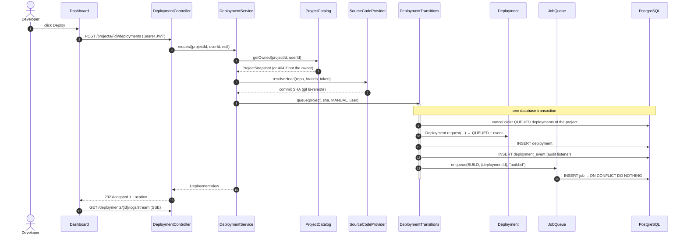
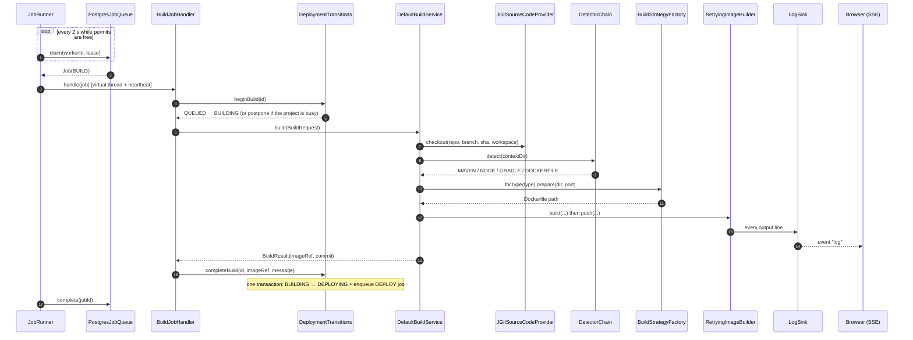
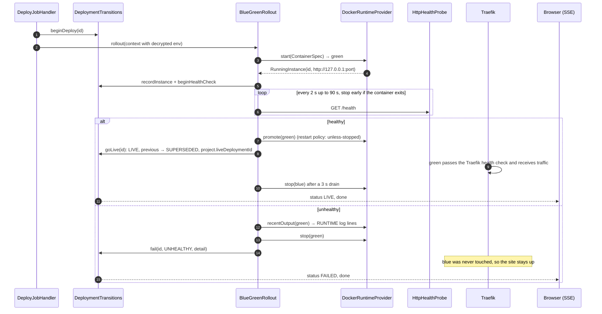
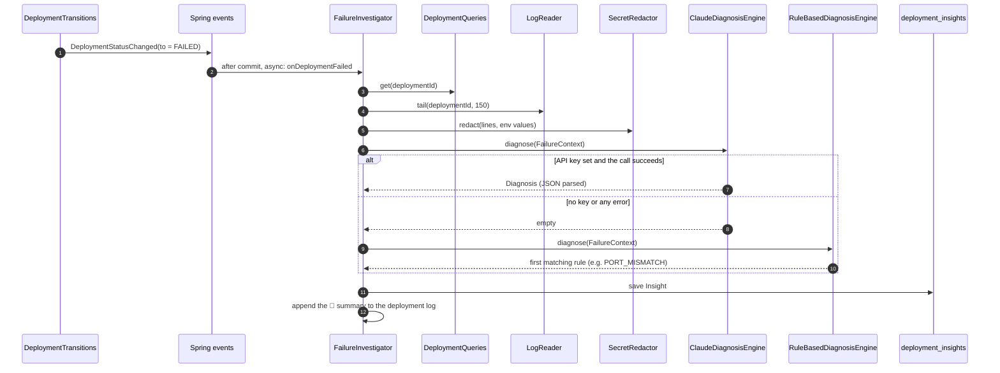
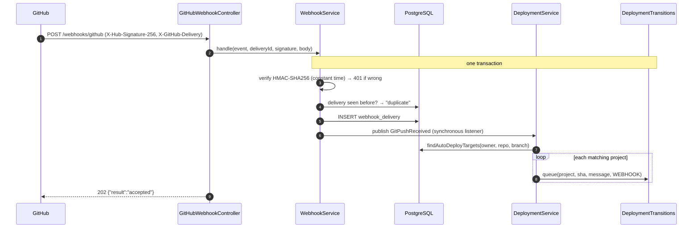
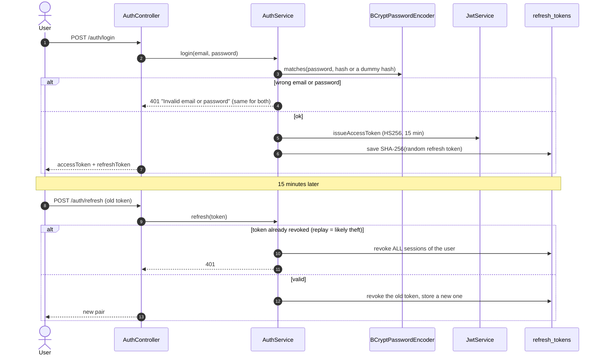
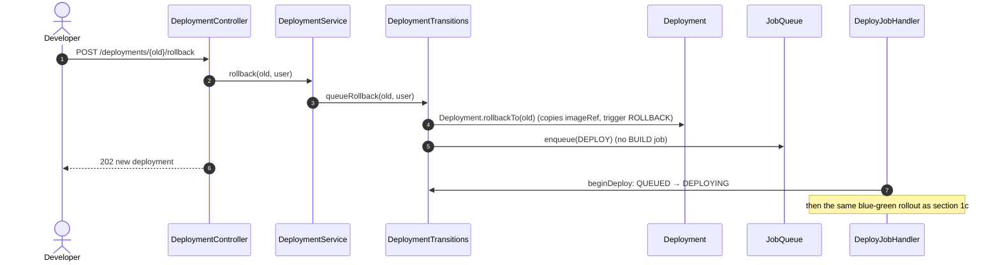
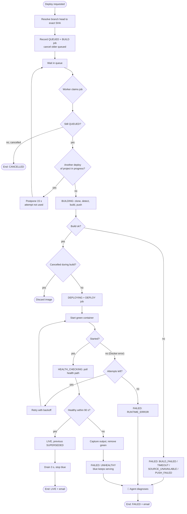
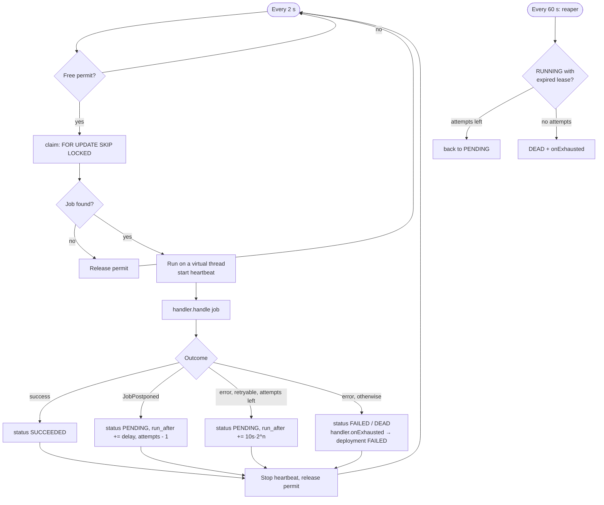
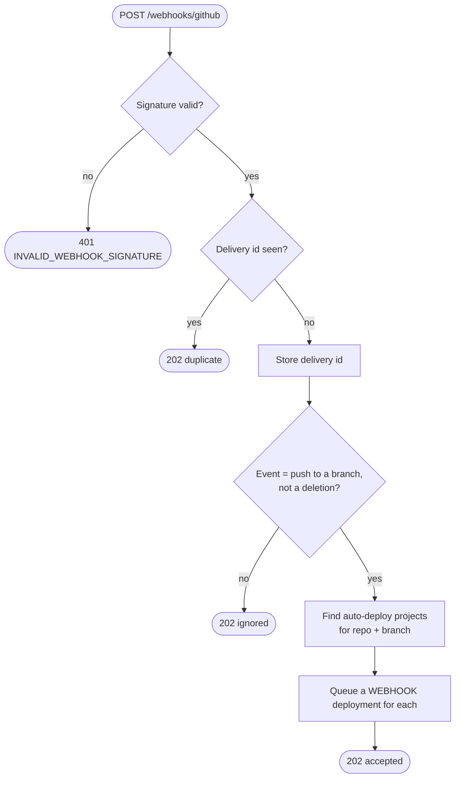

# 04 — Sequence and Activity Diagrams

> Rubric item 6: flow of control for the core use cases and how objects interact. Participant names are the real classes.

## 1. Sequence: Deploy a commit (UC5)

### 1a. Request (synchronous, milliseconds)

### 1b. Build job (asynchronous, minutes)

### 1c. Deploy job: blue-green rollout

## 2. Sequence: Failure diagnosis by the agent (UC13)

## 3. Sequence: Auto-deploy from a GitHub push (UC6)

## 4. Sequence: Login and refresh-token rotation (UC1)

## 5. Sequence: Roll back (UC9)

## 6. Activity: Deployment lifecycle

## 7. Activity: Job worker loop (one `JobRunner` instance)

## 8. Activity: Webhook handling

