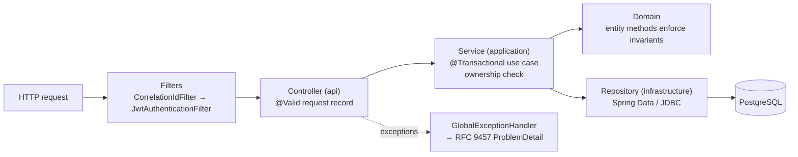

# 05 — API and Interface Design

> Rubric item 7: method signatures, request and response structures, and separation between layers. Live, always-current docs are at **`http://localhost:8080/swagger-ui.html`** (springdoc generates them from the code).

## 1. Layering of every request



| Layer | Allowed to | Not allowed to |
|-------|------------|----------------|
| Controller (`api`) | Parse and validate input, call **one** service method, map to a response record | Business rules, repositories (checked by ArchitectureTest), try/catch |
| Service (`application`) | Use cases, transactions, ownership, calling other modules' public APIs | HTTP types (`HttpServletRequest`), SQL |
| Domain (`domain`) | Invariants, state transitions, value validation | Spring Web, Docker, JGit (checked by ArchitectureTest) |
| Repository / adapter (`infrastructure`) | SQL, Docker, Git, HTTP clients | Business decisions |

## 2. Conventions

- Base path `/api/v1`. JSON everywhere. Server-Sent Events for streams.
- Auth header `Authorization: Bearer <accessToken>`. SSE endpoints (paths ending in `/stream`) also accept `?access_token=` because browsers' `EventSource` cannot send headers.
- Async operations answer **202 Accepted** with a `Location` header.
- Collections: `?page=0&size=20` (size 1–100) → `{content, page, size, totalElements, totalPages}`.
- Every response carries `X-Correlation-Id`.

### Error format (RFC 9457 Problem Details), always the same shape

```json
{
  "type": "https://forge.dev/errors/not-cancellable",
  "title": "Deployment can no longer be cancelled",
  "status": 409,
  "detail": "Deployment is HEALTH_CHECKING and can no longer be cancelled",
  "instance": "/api/v1/deployments/7f3c…/cancel",
  "code": "NOT_CANCELLABLE",
  "correlationId": "c0a8012e-…"
}
```

Validation errors add `"errors": [{"field": "password", "message": "must be 10 to 100 characters"}]`. The codes are listed in `ErrorCode.java` and in [07](07-error-handling.md).

## 3. Endpoints

### Auth (`identity.api.AuthController`)

| Method & path | Request | Response |
|---------------|---------|----------|
| `POST /auth/register` | `{email, password (10–100), displayName}` | `201 {id, email, displayName}` · `409 EMAIL_TAKEN` |
| `POST /auth/login` | `{email, password}` | `200 {accessToken, refreshToken, expiresIn}` · `401 INVALID_CREDENTIALS` |
| `POST /auth/refresh` | `{refreshToken}` | `200` new pair (the old one is revoked) · `401 INVALID_TOKEN` (replay revokes all sessions) |
| `POST /auth/logout` | `{refreshToken}` | `204` |
| `GET /me` | — | `200 {id, email, displayName}` |

### GitHub (`source.api`)

| Method & path | Response |
|---------------|----------|
| `GET /github/connection` | `{connected, login, oauthConfigured}` |
| `POST /github/connect` | `{authorizeUrl}` · `503 GITHUB_OAUTH_NOT_CONFIGURED` |
| `GET /github/callback?code&state` | `302` → `{dashboard}/settings?github=connected\|error` (public, the state identifies the user) |
| `DELETE /github/connection` | `204` |
| `GET /github/repos` | `[{owner, name, fullName, defaultBranch, isPrivate}]` · `422 GITHUB_NOT_CONNECTED` |
| `GET /github/repos/{owner}/{name}/branches` | `["main", …]` |
| `POST /webhooks/github` | Public. Headers `X-GitHub-Event`, `X-GitHub-Delivery`, `X-Hub-Signature-256`. → `202 {"result":"accepted"\|"duplicate"\|"ignored"}` · `401 INVALID_WEBHOOK_SIGNATURE` |

### Projects (`project.api`)

| Method & path | Request | Response |
|---------------|---------|----------|
| `POST /projects` | `{name, slug?, repoOwner, repoName, branch?, rootDir?, buildType?, port?, healthCheckPath?, autoDeploy?}` | `201 Project` · `409 SLUG_TAKEN` · `400 VALIDATION_FAILED` |
| `GET /projects` | page params | `Page<Project>` (only your own) |
| `GET /projects/{id}` | — | `Project` · `404` if missing **or not yours** |
| `PATCH /projects/{id}` | any create field except `slug` (null = unchanged) | `Project` |
| `DELETE /projects/{id}` | — | `204` (containers are stopped first) |
| `GET /projects/{id}/env` | — | `[{key, valuePreview, updatedAt}]` (masked: `po••••••`) |
| `PUT /projects/{id}/env` | `{vars: {KEY: "value"}}` (upsert) | `204` + `X-Forge-Redeploy-Required: true` |
| `DELETE /projects/{id}/env/{key}` | — | `204` |

`Project = {id, name, slug, repoOwner, repoName, repoUrl, branch, rootDir, buildType, port, healthCheckPath, autoDeploy, liveUrl, liveDeploymentId, createdAt, updatedAt}`

### Deployments (`deployment.api.DeploymentController`)

| Method & path | Request | Response |
|---------------|---------|----------|
| `POST /projects/{id}/deployments` | optional `{commitSha}` (40 hex) | `202 Deployment` (QUEUED) · `422 REPOSITORY_UNREACHABLE` |
| `GET /projects/{id}/deployments` | page params | `Page<Deployment>` (newest first) |
| `GET /deployments/{id}` | — | `Deployment` with `timeline` |
| `POST /deployments/{id}/cancel` | — | `202 Deployment` · `409 NOT_CANCELLABLE` |
| `POST /deployments/{id}/rollback` | — | `202` new `Deployment` · `422 NOT_ROLLBACKABLE` |
| `GET /deployments/{id}/logs?after=0&limit=500` | — | `[{seq, source, line, ts}]` |
| `GET /deployments/{id}/logs/stream` | `Last-Event-ID` header (auto on reconnect) | SSE: `log` (id = seq), `status`, `done` |
| `GET /projects/{id}/runtime-logs/stream` | — | SSE `log {line, ts}` from the live container |
| `GET /deployments/{id}/insight` | — | Agent diagnosis, or `404` until ready |

```json
// Deployment
{
  "id": "7f3c…", "projectId": "2b1e…",
  "commitSha": "3f2a9c1b0d4e5f60718293a4b5c6d7e8f9012345", "commitMessage": "feat: say hello",
  "trigger": "WEBHOOK", "status": "FAILED", "failureReason": "UNHEALTHY",
  "failureDetail": "process exited (ConnectException); container exited with code 1",
  "imageRef": "localhost:5001/forge/hello-node:3f2a9c1b0d4e", "rollbackOfId": null,
  "createdAt": "…", "startedAt": "…", "finishedAt": "…",
  "timeline": [ {"from": null, "to": "QUEUED", "message": "Deployment queued", "at": "…"}, … ]
}

// Insight
{
  "deploymentId": "7f3c…", "category": "PORT_MISMATCH",
  "summary": "The app listens on port 3000 but the project expects port 8080, so health checks could not reach it.",
  "suggestedFix": "Either change the project's port to 3000 in Settings, or make the app read the PORT environment variable (Forge sets PORT=8080).",
  "confidence": "HIGH", "engine": "rules",
  "evidence": ["Server listening on port 3000"], "createdAt": "…"
}
```

### SSE stream example

```
event: log
id: 42
data: {"seq":42,"source":"BUILD","line":"Step 4/9 : RUN npm ci","ts":"…"}

event: status
data: {"status":"HEALTH_CHECKING","failureReason":null}

event: done
data: {"status":"LIVE"}
```

## 4. Internal interfaces between modules (Java signatures)

These are the "API" one module offers another (root-package types, see [02 §3](02-architecture.md#3-modules-modular-monolith)).

```java
// project
public interface ProjectCatalog {
  ProjectSnapshot getOwned(UUID projectId, UUID ownerId);      // NotFoundException if not owner
  ProjectSnapshot get(UUID projectId);
  List<ProjectSnapshot> findAutoDeployTargets(String owner, String repo, String branch);
  Map<String, String> environmentOf(UUID projectId);           // decrypted, only for container start
  void recordLiveDeployment(UUID projectId, UUID deploymentId);
}

// source
public interface SourceCodeProvider {
  String resolveHead(GitRepository repo, String branch, Optional<String> token);
  CommitInfo checkout(GitRepository repo, String branch, String sha, Path dir, Optional<String> token);
}

// build
public interface BuildService { BuildResult build(BuildRequest request); }   // throws BuildFailedException

// runtime
public interface RuntimeProvider {
  RunningInstance start(ContainerSpec spec);
  void promote(String instanceId);
  void stop(String instanceId);                                 // idempotent
  boolean isRunning(String instanceId);
  String exitDescription(String instanceId);
  List<String> recentOutput(String instanceId, int lines);
  Closeable followOutput(String instanceId, int tail, Consumer<String> lines);
}

// health
public interface HealthProbe {
  HealthResult awaitHealthy(URI baseUrl, String path, Duration timeout, BooleanSupplier stillAlive);
}

// jobs
public interface JobQueue { void enqueue(JobType type, Object payload, String idempotencyKey); }
public interface JobHandler {
  JobType type(); void handle(Job job); boolean isRetryable(Throwable e); void onExhausted(Job job, Throwable e);
}

// logs
public interface LogSink    { void append(UUID deploymentId, LogSource source, String text); }
public interface LogReader  { List<LogLine> after(UUID id, int afterSeq, int limit); List<LogLine> tail(UUID id, int n); }
public interface LogStreams { SseEmitter subscribe(UUID id, int afterSeq); void publishStatus(UUID id, String status, String reason, boolean terminal); }

// deployment
public interface DeploymentQueries { DeploymentView get(UUID id); DeploymentView getOwned(UUID id, UUID userId); }
public record DeploymentStatusChanged(UUID deploymentId, UUID projectId, DeploymentStatus from,
    DeploymentStatus to, FailureReason failureReason, String message, Instant occurredAt) {}
```

## 5. HTTP status codes used

| Code | Meaning in Forge |
|------|------------------|
| 200 / 201 / 204 | OK / created / no body |
| 202 | Accepted for asynchronous processing (deploy, cancel, rollback, webhook) |
| 302 | OAuth callback redirect |
| 400 | Validation failed (shape or domain rule) |
| 401 | Missing or invalid token, bad credentials, bad webhook signature |
| 404 | Not found **or not yours** |
| 409 | Conflict: email or slug taken, not cancellable, illegal transition, concurrent update |
| 422 | Semantically impossible: repo unreachable, nothing to roll back to, GitHub not connected |
| 502 / 503 | External dependency failed, or the feature is not configured |
