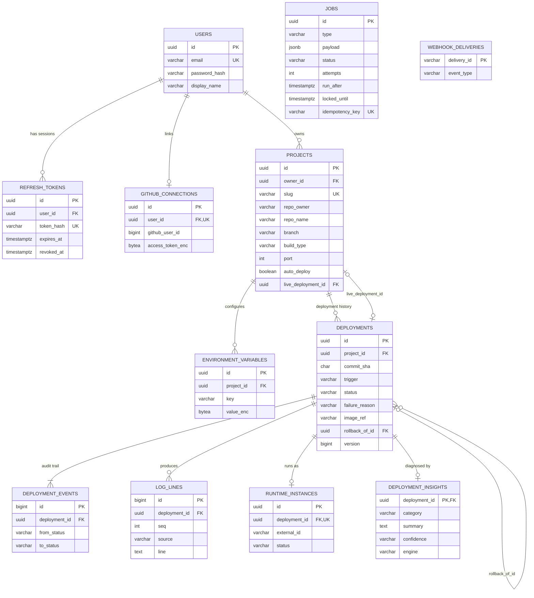

# 06 — Database Schema (PostgreSQL 16)

> Rubric item 8: tables, keys, relationships and indexes mapped from the class design. The real DDL is in `forge-server/src/main/resources/db/migration/V1…V7`. Flyway applies it, and Hibernate only **validates** that entities match (`ddl-auto: validate`).

## 1. ER diagram



`JOBS` and `WEBHOOK_DELIVERIES` are infrastructure tables. Jobs reference deployments only inside their JSON payload, on purpose: the queue is generic and knows nothing about deployments.

## 2. Class → table mapping

| Class (module) | Table | Mapping notes |
|----------------|-------|---------------|
| `User` (identity) | `users` | Email stored normalised (lower-case). Unique index on `lower(email)`. |
| `RefreshToken` (identity) | `refresh_tokens` | Composition with User → `ON DELETE CASCADE`. Only the SHA-256 is stored. |
| `GitHubConnection` (source) | `github_connections` | `user_id UNIQUE` enforces the 0..1 multiplicity |
| `WebhookDelivery` (source) | `webhook_deliveries` | The PK is GitHub's delivery id, so de-duplication is free |
| `Project` (project) | `projects` | Value objects are **embedded as columns**: `Slug` → `slug`, `RepoRef` → `repo_owner`, `repo_name`, `BuildSettings` → `branch`, `root_dir`, `build_type`, `port`, `health_check_path`, `auto_deploy` |
| `EnvironmentVariable` (project) | `environment_variables` | Composition → cascade. `UNIQUE(project_id, key)`. `value_enc` = AES-GCM bytes. |
| `Deployment` (deployment) | `deployments` | Enums stored as `VARCHAR` + `CHECK`. `@Version` → `version`. Self-association `rollback_of_id`. |
| `DeploymentEvent` (deployment) | `deployment_events` | Append-only. `BIGSERIAL` id preserves the order. |
| `RuntimeInstanceRecord` (deployment) | `runtime_instances` | `deployment_id UNIQUE` enforces 0..1 |
| `LogLine` (logs, record) | `log_lines` | Written with JDBC (high volume). `UNIQUE(deployment_id, seq)`. |
| `Insight` (agent) | `deployment_insights` | Shared primary key with `deployments` enforces 0..1 |
| `Job` (jobs, record) | `jobs` | JDBC only. Payload is `jsonb`. |

Relationships between **modules** are stored as plain id columns (e.g. `projects.owner_id`), not JPA `@ManyToOne` links. Modules stay independent at the object level, while the database still enforces referential integrity with foreign keys.

## 3. Keys and constraints that carry business rules

```sql
-- One account per email, case-insensitive
CREATE UNIQUE INDEX ux_users_email ON users (lower(email));

-- The slug becomes a DNS label: the database refuses anything else
slug VARCHAR(63) NOT NULL UNIQUE CHECK (slug ~ '^[a-z0-9]([a-z0-9-]{0,61}[a-z0-9])?$')

-- FR-11: at most ONE in-progress deployment per project, enforced even if application code races
CREATE UNIQUE INDEX ux_deployments_one_active ON deployments (project_id)
    WHERE status IN ('BUILDING','DEPLOYING','HEALTH_CHECKING');

-- Status can only be a known state
status VARCHAR(20) NOT NULL CHECK (status IN ('QUEUED','BUILDING','DEPLOYING','HEALTH_CHECKING',
                                              'LIVE','FAILED','CANCELLED','SUPERSEDED','STOPPED'))

-- The same job can't be queued twice (e.g. 'build:<deploymentId>')
idempotency_key VARCHAR(100) UNIQUE

-- Env var keys must be valid shell identifiers
key VARCHAR(255) NOT NULL CHECK (key ~ '^[A-Za-z_][A-Za-z0-9_]*$'), UNIQUE (project_id, key)
```

## 4. Indexes and the queries they serve

| Index | Serves |
|-------|--------|
| `ix_projects_owner (owner_id)` | "My projects" list |
| `ix_projects_repo (repo_owner, repo_name, branch)` | Webhook → find auto-deploy projects |
| `ix_deployments_project_created (project_id, created_at DESC)` | Deployment history page |
| `ux_deployments_one_active` (partial) | The in-progress rule + "is another deploy running?" |
| `ix_deployment_events_deployment (deployment_id, id)` | Timeline of one deployment |
| `UNIQUE (deployment_id, seq)` on log_lines | Log paging (`seq > ?`) and SSE resume |
| `ix_jobs_claimable (run_after, created_at) WHERE status = 'PENDING'` (partial) | The worker claim query. Stays small however many finished jobs pile up. |
| `ix_jobs_expired_lease (locked_until) WHERE status = 'RUNNING'` (partial) | The crash-recovery reaper |
| `ix_refresh_tokens_user (user_id)` | Revoke all sessions of a user |

## 5. Design decisions

| Decision | Reason |
|----------|--------|
| UUID primary keys (generated in Java) | Safe to expose in URLs (not guessable). The id is known before insert, so events can reference it. |
| `TIMESTAMPTZ` everywhere, JVM pinned to UTC for JDBC | No time-zone bugs |
| Enums as `VARCHAR + CHECK`, not PG enums | Adding a value is a simple migration |
| Append-only `deployment_events` | Full audit: when and why every status changed |
| Secrets as `BYTEA` ciphertext | A database dump alone reveals nothing |
| Postgres also stores the job queue and logs | One transactional store: the deployment and its job commit together. Logs at real scale would move to object storage or Loki (future work). |
| Never edit an applied migration | Every environment is reproducible from `V1…V7` |
