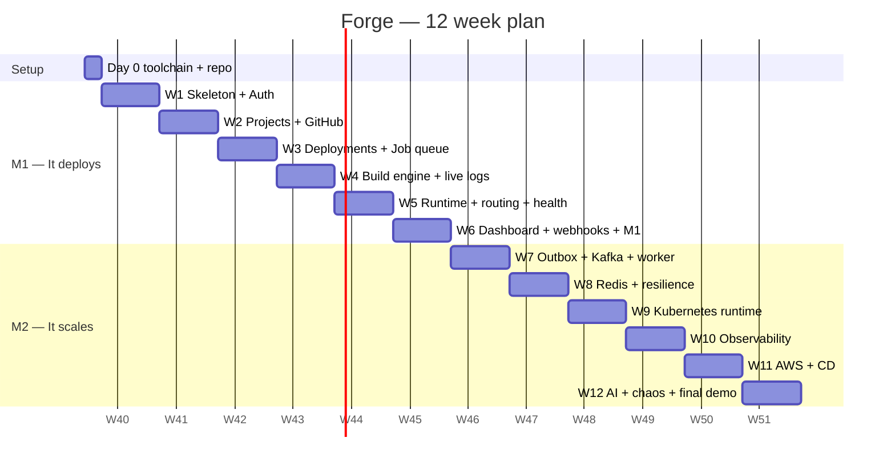

# 06 — Roadmap: Day 0 → Week 12

Every week ends with:
1. a **demo-able deliverable**,
2. a **Definition of Done (DoD)**,
3. a list of **concepts you must be able to explain**, and
4. merged PRs with green CI.

The schedule assumes about 15–20 hours a week. If you fall behind, cut the items marked *(stretch)* first. Never cut tests.

---

## Day 0 — Environment and repository (1–2 days)

**Goal:** a reproducible dev environment and an empty, *working* skeleton committed to GitHub.

### Install

| Tool | Version | Command (macOS) | Check |
|------|---------|-----------------|-------|
| JDK | **21** (Temurin) | `brew install --cask temurin@21` (you currently have 17) | `java -version` → 21 |
| IntelliJ IDEA | latest | Community or Ultimate (free with student license) | — |
| Docker Desktop | latest | already installed ✅ | `docker run hello-world` |
| Node.js | 22 LTS | `brew install node@22` (dashboard only) | `node -v` |
| Git + GitHub CLI | latest | `brew install gh` | `gh auth status` |
| (W9) kind, kubectl, helm | latest | `brew install kind kubectl helm` | `kind version` |

Maven does **not** need to be installed globally. We use the Maven wrapper (`./mvnw`) so every machine and the CI server use the same version.

### Repository setup

- [ ] `git init` in this folder (it is currently nested inside a larger repo, so give Forge **its own** repo) and create a GitHub repo `forge`
- [ ] Generate the skeleton at [start.spring.io](https://start.spring.io): Maven, Java 21, Spring Boot 3.5.x, group `com.forge`, artifact `forge-server`. Dependencies: Web, Security, Data JPA, Validation, Actuator, PostgreSQL Driver, Flyway, Lombok (optional), Testcontainers, Spring Boot DevTools.
- [ ] Restructure into a Maven multi-module parent (`pom.xml` → `forge-server`)
- [ ] `.gitignore`, `.editorconfig`, `README.md`, `docs/` (these planning docs)
- [ ] `infra/docker-compose.yml` with **postgres:16** only, for now
- [ ] `application.yml` with profiles `dev` / `test` / `prod`. Secrets come from env vars, and `.env.example` is committed while `.env` is git-ignored.
- [ ] GitHub Actions `ci.yml`: `./mvnw -B verify` on every PR
- [ ] Branch protection on `main`: PR plus green CI required
- [ ] Create the sample apps `sample-apps/hello-spring` (Spring Boot + `/actuator/health`) and `sample-apps/hello-node` (Express + `/health`) and push each to **its own public GitHub repo**. These are what Forge deploys during demos.
- [ ] Register a **GitHub OAuth App** (Settings → Developer settings) with callback `http://localhost:8080/api/v1/github/callback`

**DoD:** `docker compose up -d && ./mvnw spring-boot:run` → `GET /actuator/health` returns `{"status":"UP"}`. CI is green.

**Explain:** What is a build tool? Why the Maven wrapper? What are Spring profiles? Why are secrets in env vars and not in git?

---

## Milestone 1 — "It deploys" (weeks 1–6)

### Week 1 — Skeleton, cross-cutting concerns, auth

| Day | Tasks |
|-----|-------|
| 1 | Package-by-feature skeleton (`shared`, `identity`, …). Add `ModularityTest` (Spring Modulith `ApplicationModules.verify()`) so boundary violations fail the build from day one. |
| 2 | `shared`: `ForgeException` hierarchy, `GlobalExceptionHandler` → `ProblemDetail`, `CorrelationIdFilter` (MDC), JSON logging in prod |
| 3 | Flyway `V1__identity.sql`. `User` entity, `UserRepository`. Testcontainers base class `AbstractIntegrationTest`. |
| 4 | `PasswordEncoder` (BCrypt), `AuthService.register/login`, `JwtService` (sign/verify with `nimbus-jose-jwt` or `jjwt`) |
| 5 | `SecurityFilterChain` (stateless, JWT filter), refresh-token rotation, `/me` |
| 6–7 | Tests: unit (`AuthService`), integration (register → login → `/me` → refresh). Swagger UI. |

**Deliverable:** register and log in through Swagger, and call `/me` with the token.
**DoD:** ≥ 80 % coverage on `identity.application`. A wrong password returns 401 with a generic message.
**Explain:** How a JWT works (header.payload.signature) and why it is stateless. Why BCrypt and not SHA-256. Why refresh tokens rotate. What a servlet filter chain is.

### Week 2 — Projects, env vars (encrypted), GitHub connection

| Day | Tasks |
|-----|-------|
| 1 | `V3__project.sql`. `Project` aggregate, value objects `Slug`, `RepoRef` (records with validation). |
| 2 | `ProjectService` CRUD with an **ownership check** in every query. `ProjectController` plus DTO records and mapping. |
| 3 | `EncryptionService` (AES-256-GCM, random 12-byte IV per value, key from env). Unit tests: round-trip, tamper detection. |
| 4 | Env var endpoints (masked reads). `V2__source.sql`. |
| 5 | GitHub OAuth flow (`/github/connect` → callback → store the encrypted token). `state` param for CSRF. |
| 6 | `GitHubApiClient` (Spring `RestClient`): list repos and branches, resolve the branch HEAD SHA. WireMock tests. |
| 7 | Buffer / refactor / tests |

**Deliverable:** connect GitHub, list repos, and create a project from one of them.
**DoD:** user B cannot read or modify user A's project (integration test returns 404).
**Explain:** Symmetric encryption, IVs, and authenticated encryption (GCM). The OAuth 2.0 authorization-code flow. Why to return 404 instead of 403. DTO vs entity.

### Week 3 — Deployment aggregate, state machine, job queue

| Day | Tasks |
|-----|-------|
| 1 | `V4__deployment.sql`. `Deployment` entity with `transitionTo` and `@Version`. `DeploymentStatus` with the transition table. |
| 2 | **Exhaustive unit tests of the state machine** (every legal transition passes, every illegal one throws). Parameterised JUnit tests. |
| 3 | `V6__jobs.sql`. `JobQueue` interface + `PostgresJobQueue` (enqueue, claim with `SKIP LOCKED`, complete, fail with backoff). |
| 4 | `JobRunner` (`@Scheduled` poll, virtual-thread executor, `Semaphore`), `AbstractJobHandler` (Template Method), `StaleJobReaper`. |
| 5 | `DeploymentService.requestDeployment`: resolve SHA → insert deployment + job in **one transaction** → 202. Supersede older `QUEUED` deploys. |
| 6 | A temporary `FakeBuildJobHandler` (sleeps, logs) to prove the pipeline end to end. Cancel endpoint. |
| 7 | **Concurrency test:** 3 runner threads and 50 jobs, so each job runs exactly once. |

**Deliverable:** POST deploy → status moves `QUEUED → BUILDING → …` (faked), visible via `GET /deployments/{id}`.
**DoD:** the concurrency test passes reliably. Killing the app mid-job means the job is re-run after the lease expires.
**Explain:** The State pattern. Optimistic vs pessimistic locking. `SKIP LOCKED`. Leases and visibility timeouts. Exponential backoff. Why `202 Accepted`. Template Method.

### Week 4 — Build engine and live logs

| Day | Tasks |
|-----|-------|
| 1 | `SourceCodeProvider` + `JGitSourceCodeProvider`: shallow clone at an exact SHA into a temp workspace, cleaned up in `finally`. |
| 2 | `BuildTypeDetector` chain + `BuildStrategy` implementations + Dockerfile templates (Maven, Gradle, Node). Unit tests with fixture folders. |
| 3 | Add `registry:2` to compose. `DockerJavaImageBuilder`: build with streamed output and push. Tag = `forge/<slug>:<shortSha>`. |
| 4 | `V5` log tables. `LogSink` → batch insert + in-memory broadcaster. |
| 5 | SSE endpoint `/deployments/{id}/logs/stream` with `Last-Event-ID` replay |
| 6 | Real `BuildJobHandler` replaces the fake. Build timeout (10 min). Failure → `FAILED(BUILD_FAILED)` with the last lines as detail. |
| 7 | Integration test: build `hello-spring` and `hello-node` for real (tagged `@Tag("docker")`) |

**Deliverable:** click deploy → watch real `docker build` logs stream in the browser (curl `-N` works too) → the image appears in the registry.
**DoD:** a broken repo (a syntax error) ends in `FAILED` with a readable log. Workspaces are always deleted.
**Explain:** Strategy vs Chain of Responsibility. Open/Closed with a concrete example. What a Docker image layer is and why multi-stage builds matter. SSE vs WebSocket vs polling.

### Week 5 — Runtime, routing, health checks, blue-green

| Day | Tasks |
|-----|-------|
| 1 | Add **Traefik** to compose (Docker provider, `exposedByDefault=false`). Network `forge-apps`. |
| 2 | `RuntimeProvider` + `DockerRuntimeProvider`: create and start a container with env vars (decrypted only at this moment), CPU and memory limits, Traefik labels `Host(<slug>.localhost)`, and a Traefik health check. |
| 3 | `HttpHealthProbe` (Java `HttpClient`, retry every 2 s, 60 s timeout) |
| 4 | `BlueGreenRollout` + `DeployJobHandler`. Mark the old deployment `SUPERSEDED`, set `projects.live_deployment_id`. |
| 5 | Runtime logs SSE (`docker logs --follow` via docker-java). Stop-project endpoint. |
| 6 | Test the failure path: an app that crashes on boot → `FAILED(UNHEALTHY)`, **and the old version still serves**. |
| 7 | Buffer |

**Deliverable:** `http://hello-spring.localhost` is live. Push v2 → zero-downtime swap. Push a broken v3 → v2 keeps serving.
**DoD:** run `while true; do curl -s hello-spring.localhost; done` during a deploy, and no request fails.
**Explain:** Control plane vs data plane. Reverse proxies and Host-based routing. Blue-green vs rolling vs recreate. Liveness vs readiness. Why env vars are decrypted only at container start.

### Week 6 — Dashboard, webhooks, notifications, M1 hardening

| Day | Tasks |
|-----|-------|
| 1–2 | `forge-dashboard` (Next.js + Tailwind): login, project list, create project (repo picker), project page (live URL, deploy button, history). |
| 3 | Deployment page: status timeline + live log viewer (`EventSource`). |
| 4 | GitHub webhook endpoint: HMAC verify, dedup via `webhook_deliveries`, branch filter → auto-deploy. Use **smee.io** to forward webhooks to localhost. |
| 5 | `notification` module: `@TransactionalEventListener` → email (Mailpit locally) on LIVE / FAILED. |
| 6 | Full `docker compose up` (server + dashboard + infra). README "Run locally in 3 commands". |
| 7 | **M1 demo rehearsal** + tag `v1.0.0` |

**Deliverable / M1 demo:** `git push` on hello-spring → dashboard shows the build streaming → live in under 2 minutes → email received.
**Explain:** The webhook security model (HMAC, replay, dedup). Observer pattern / domain events. Why `AFTER_COMMIT`.

---

## Milestone 2 — "It scales and survives failure" (weeks 7–12)

### Week 7 — Transactional outbox, Kafka, extract `forge-worker`

- [ ] Add Kafka (KRaft mode, no ZooKeeper) to compose, plus Kafka UI
- [ ] `V7__outbox.sql`. `OutboxWriter` used inside `@Transactional` services. `OutboxRelay` (poll + `SKIP LOCKED` + publish + mark published).
- [ ] `KafkaJobQueue` implements the **same** `JobQueue` interface. Switch with `forge.jobs.transport=postgres|kafka`.
- [ ] New Maven module `forge-worker` (Spring Boot, no web). Move `build` + `runtime` handlers into it. A shared `forge-contracts` module holds the event records.
- [ ] Idempotent consumer (`processed_events`), `DefaultErrorHandler` with backoff → `.DLT` topic
- [ ] Test: run **3 worker instances** (`docker compose up --scale forge-worker=3`) and watch the partitions spread
- [ ] Test: kill a worker mid-build → Kafka rebalances → another worker finishes

**Explain:** The dual-write problem. Outbox. At-least-once + idempotency = effectively-once. Partitions, keys, ordering, consumer groups, rebalancing. Why we extracted *these* modules (independent scaling, failure isolation, different resource profiles), not all of them.

### Week 8 — Redis and resilience

- [ ] Redis in compose. `Idempotency-Key` support on `POST /deployments` (store the response, replay it on a repeat).
- [ ] Rate limiting (Bucket4j + Redis) → `429` + `Retry-After`
- [ ] Live log fan-out through Redis pub/sub, so SSE works when `forge-server` has 2 replicas
- [ ] Cache the GitHub repo list (`@Cacheable`, 5 min TTL)
- [ ] Resilience4j: `@Retry` (exponential + jitter) and `@CircuitBreaker` on `GitHubApiClient` and registry calls. `@TimeLimiter` on health probes.
- [ ] Fault-injection tests with WireMock (GitHub returns 500 → retries → circuit opens → fast 503)

**Explain:** Idempotency keys (how Stripe does it). Token bucket. Pub/sub vs queue. Circuit breaker states (closed → open → half-open). Retry storms and why jitter matters. Cache invalidation trade-offs.

### Week 9 — Kubernetes runtime provider

- [ ] Local cluster with **kind** + Traefik ingress controller + local registry wiring
- [ ] `KubernetesRuntimeProvider` (fabric8): per-app `Deployment` (resources, readiness/liveness probes, env from a `Secret`), `Service`, `Ingress`
- [ ] `KubernetesRollingRollout`: `maxSurge 1 / maxUnavailable 0`, wait for the rollout, `rollout undo` on failure
- [ ] `HorizontalPodAutoscaler` (CPU 70 %, 1–3 replicas) + `metrics-server`
- [ ] Rollback endpoint (re-deploy the old `imageRef`, skip the build) for **both** providers
- [ ] Kubernetes manifests for Forge itself in `infra/k8s/` (server, worker, configmaps, secrets)

**Explain:** Pod / Deployment / ReplicaSet / Service / Ingress. Rolling update mechanics. Readiness vs liveness. How the HPA decides. *Liskov Substitution in practice:* the same `DeployJobHandler` works on Docker and K8s.

### Week 10 — Observability

- [ ] Micrometer custom metrics: `forge_deployments_total{status}`, `forge_build_duration_seconds` (histogram), `forge_jobs_queue_depth` (gauge), `forge_deploy_lead_time_seconds`
- [ ] Prometheus + Grafana in compose/k8s. Provisioned dashboards (JSON in git): **Platform** (RED + queue depth + failure rate) and **Per-app** (CPU / memory / requests).
- [ ] Structured JSON logs with `correlationId`, `deploymentId`, `projectId`
- [ ] *(stretch)* OpenTelemetry tracing → Jaeger/Tempo: follow one deployment across server → Kafka → worker
- [ ] Alert rule examples: build failure rate > 30 %, queue depth > 20 for 5 min

**Explain:** Metrics vs logs vs traces (the three pillars). RED and USE methods. Counter vs gauge vs histogram. Percentiles. Why cardinality matters (never use `deploymentId` as a metric label).

### Week 11 — AWS deployment and continuous delivery

- [ ] EC2 (t3.medium or t3.large) + **k3s**. Security group: only ports 80, 443, and 22 (your IP).
- [ ] AWS **ECR** as the registry (IAM role on the instance, no static keys)
- [ ] Postgres: RDS free tier **or** a StatefulSet in k3s (state the trade-off)
- [ ] Domain + wildcard DNS `*.forge.<yourdomain>` → EC2. TLS with Let's Encrypt via Traefik/cert-manager.
- [ ] GitHub Actions CD: on tag → build images → push to ECR → `kubectl apply`/`helm upgrade`
- [ ] Budget alarm in AWS Billing (**do this first**: $10 alert)

**Explain:** VPC/security groups basics. IAM roles vs access keys. Wildcard DNS. TLS termination at the ingress. CI vs CD. Cost reasoning (k3s vs EKS).

### Week 12 — AI investigator, chaos testing, final polish

- [ ] `FailureInvestigator` listens for `DeploymentFailed` → collects the status timeline + last 200 log lines (with secrets redacted) → LLM API (behind an `LlmClient` interface so the provider can be swapped) → stores `deployment_insights` → shows them in the UI
- [ ] Load test with **Gatling (Java DSL)**: 50 concurrent deploy requests, measure queue drain time with 1 vs 3 workers. Put the graph in the report.
- [ ] Chaos script: kill a worker, restart Kafka, stop Redis. Record the observed behaviour against the [failure-mode table](02-architecture-hld.md#11-failure-mode-table-instructors-love-this).
- [ ] Final report, architecture poster, recorded demo video (backup in case the live demo fails)
- [ ] Tag `v2.0.0`

**Final demo script:** see [08-viva-guide.md](08-viva-guide.md).

---

## Risk register

| Risk | Likelihood | Mitigation |
|------|------------|------------|
| Docker-in-Docker / socket complexity when `forge-server` itself runs in a container | High | In M1 run the server on the host (IDE). When containerised, mount `/var/run/docker.sock` **only** into forge-server/worker, never into user apps. |
| Webhooks can't reach localhost | High | smee.io / ngrok in dev, a real domain in W11 |
| Kafka/K8s learning curve eats the schedule | Medium | The M1 design already has interfaces (`JobQueue`, `RuntimeProvider`), so M2 is adding implementations, not rewriting |
| AWS cost overrun | Medium | Budget alarm, stop EC2 when not demoing, k3s not EKS |
| Live demo fails | Medium | Pre-recorded video + pre-built images in the registry |
| Scope creep | High | The PRD "Out of scope" list. *(stretch)* items are cut first. |
