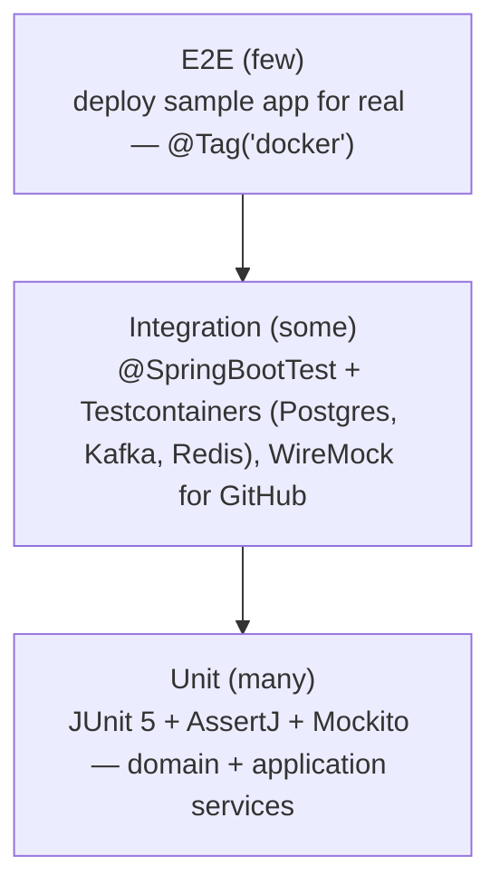
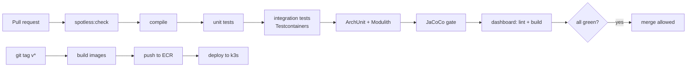

# 07 — Engineering Standards

These are the rules we follow on every PR. When the instructor asks *"what best practices did you follow?"*, this page is the answer, and the CI pipeline enforces most of it automatically.

## 1. Java code style

| Rule | Example / reason |
|------|------------------|
| Formatting is automatic (**Spotless + google-java-format**) | `./mvnw spotless:apply`. CI fails if the code is not formatted, so there are no style debates in review. |
| **Constructor injection only.** No `@Autowired` on fields. | Dependencies are explicit, fields can be `final`, and classes are testable without Spring. |
| Use `record` for DTOs, events, and value objects | Immutable, with `equals`/`hashCode` for free |
| Entities are **never** returned from controllers | Map to response DTOs, so the API contract doesn't change when the DB does, and nothing leaks (for example `passwordHash`) |
| No `null` returns from public methods | Return `Optional<T>` for "may be absent", and empty collections for "none" |
| Validate at the boundary | Jakarta Bean Validation (`@Valid`, `@NotBlank`, `@Min`) on request DTOs. Invariants are re-checked in domain constructors. |
| Fail fast with domain exceptions | `throw new NotFoundException("Project", id)`. Never `return null` or swallow exceptions. |
| No business logic in controllers | Controller = parse → call one service method → map response |
| `@Transactional` on **application-service** methods only | Not on controllers or repositories. Keep transactions short and **never** hold one open across network I/O (docker build, HTTP calls). |
| Names reveal intent | `markHealthChecking()` not `setStatus(3)`. `ImageRef` not `String image`. |
| Small methods, small classes | Aim for methods under about 20 lines. If a class needs "and" to describe it, split it. |
| No magic numbers or strings | Use `@ConfigurationProperties` records (`ForgeBuildProperties.timeout()`), constants, or enums |
| Logging: SLF4J with placeholders | `log.info("Deployment {} moved to {}", id, status)`. **Never log secrets, tokens, or env-var values.** |
| Use Java 21 features where they clarify | Records, sealed interfaces, pattern-matching `switch`, text blocks (Dockerfile templates), virtual threads |

### Package rules (enforced by tests)

```java
class ModularityTest {
    @Test
    void modulesRespectBoundaries() {
        ApplicationModules.of(ForgeApplication.class).verify();   // Spring Modulith
    }
}

class LayerRulesTest {   // ArchUnit
    @ArchTest
    static final ArchRule domainIsPure = noClasses().that().resideInAPackage("..domain..")
            .should().dependOnClassesThat().resideInAnyPackage(
                    "..infrastructure..", "..api..", "org.springframework.web..",
                    "com.github.dockerjava..", "org.eclipse.jgit..");

    @ArchTest
    static final ArchRule controllersDontTouchRepositories = noClasses().that().resideInAPackage("..api..")
            .should().dependOnClassesThat().haveSimpleNameEndingWith("Repository");
}
```

## 2. Testing strategy (test pyramid)



| Layer | What to test | Tools |
|-------|--------------|-------|
| Unit | State machine (every transition), value-object validation, encryption round-trip, detectors with fixture folders, Dockerfile generation, backoff calculation | JUnit 5, AssertJ, Mockito |
| Slice | Controllers (validation, status codes, ProblemDetail shape) | `@WebMvcTest` + MockMvc |
| Integration | Repositories and SQL (`SKIP LOCKED` claim, partial unique index), full auth flow, outbox relay | `@SpringBootTest`, **Testcontainers** (a real Postgres, never H2) |
| Contract with externals | GitHub API client, including 4xx/5xx and timeouts | **WireMock** |
| E2E | Build and deploy `hello-spring` through the real Docker engine | `@Tag("docker")`, run in CI on `main` |
| Architecture | Module boundaries, layer rules | Spring Modulith, **ArchUnit** |
| Load / chaos | Queue throughput, worker crash recovery | Gatling (Java DSL), scripts |

**Rules**
- Test names describe behaviour: `rejectsTransitionFromLiveToBuilding()`, `claimReturnsEachJobToExactlyOneWorker()`.
- Arrange / Act / Assert structure, one behaviour per test.
- Write a failing test before fixing every bug (regression test).
- Coverage gate (**JaCoCo**): ≥ 70 % lines overall, ≥ 85 % on `*.domain` packages. CI fails below that.

## 3. Git workflow

- `main` is always deployable and protected (PR + green CI required).
- One branch per task: `feat/w3-job-queue`, `fix/sse-reconnect`, `docs/hld-diagrams`.
- **Conventional Commits:** `feat(deployment): add state machine transitions`, `fix(build): clean workspace on failure`, `test(jobs): concurrency test for claim`, `docs: …`, `refactor: …`, `chore: …`.
- Small PRs (under about 400 lines). The PR description covers *what*, *why*, *how tested*, and screenshots or a curl for API changes.
- Self-review your diff before requesting review. Squash-merge.
- Tags: `v1.0.0` (M1), `v2.0.0` (M2).

## 4. CI pipeline (GitHub Actions)



Also: Dependabot for dependency updates, and the GitHub secret-scanning alert left on.

## 5. Configuration and secrets

| Kind | Where |
|------|-------|
| Non-secret defaults | `application.yml` |
| Per-environment overrides | `application-dev.yml`, `application-prod.yml` |
| Secrets (DB password, JWT signing key, encryption master key, GitHub client secret) | **Environment variables only.** `.env` locally (git-ignored, `.env.example` committed), K8s `Secret` in the cluster. |
| Typed access | `@ConfigurationProperties(prefix = "forge.build") record ForgeBuildProperties(Duration timeout, int maxConcurrent) {}` with `@Validated` |

## 6. API design rules

- Resource-oriented nouns: `/projects/{id}/deployments`, not `/createDeployment`.
- Correct status codes (see [05](05-api-spec.md#http-status-codes-used)). `202` for async work.
- Every error is a `ProblemDetail` with a stable machine-readable `code`.
- Collections are always paginated.
- Backward-compatible changes only within `/v1`.

## 7. Database rules

- Flyway only. Never edit an applied migration. Never use `ddl-auto=update` (set to `validate`).
- Every foreign key column is indexed. Every query used by the UI has an index (check with `EXPLAIN ANALYZE`).
- Invariants that matter are enforced **in the DB too** (`UNIQUE`, `CHECK`, partial unique index), not only in Java.
- Avoid N+1 queries: use `@EntityGraph` or fetch joins, and turn on Hibernate statistics in dev to catch them.

## 8. Documentation rules

- Every module has a `package-info.java` with a one-paragraph description of its responsibility.
- Every architectural decision gets an ADR row in [02 §10](02-architecture-hld.md#10-technology-decisions-adr-summary).
- Javadoc on **public interfaces** (ports): contract, preconditions, and exceptions. Not on obvious getters.
- Update diagrams in the same PR as the code that changes them.

## 9. Definition of Done (applies to every task)

- [ ] Code formatted, compiles, no new warnings
- [ ] Unit + integration tests written and passing, coverage gate green
- [ ] Error paths handled and tested (not just the happy path)
- [ ] No secrets in code, logs, or commits
- [ ] API docs (Swagger) and these docs updated if behaviour changed
- [ ] PR reviewed (self-review at minimum) and merged with a conventional commit message
- [ ] You can explain the change in two minutes without notes
