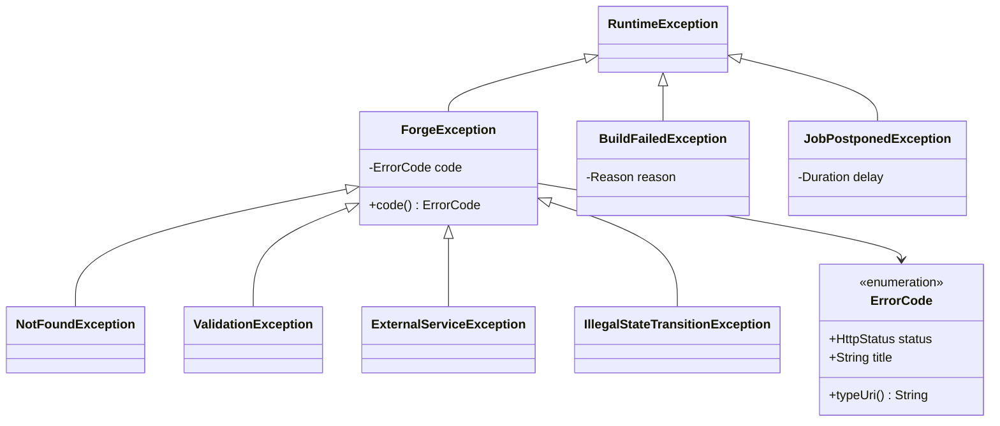

# 07 — Error Handling, Validation, Edge Cases and Concurrency

> Rubric item 9: how the system behaves on invalid input, failures and concurrency.

## 1. One error model

- **`ForgeException`**: an expected business failure. Its `ErrorCode` decides the HTTP status. `GlobalExceptionHandler` (one `@RestControllerAdvice`) converts it to an RFC 9457 `ProblemDetail` with `code` and `correlationId`. Controllers contain **no try/catch**.
- **`BuildFailedException`**: not an HTTP error. It is recorded on the deployment as a `FailureReason`.
- **`JobPostponedException`**: a control-flow signal to the job runner ("not now, try later").
- Unknown exceptions → 500 with a generic message (no stack traces leak). The full error is logged with the correlation id, so a user can quote it.

| ErrorCode | HTTP | Raised when |
|-----------|------|-------------|
| `VALIDATION_FAILED` | 400 | Bean Validation on a request record, or a domain value object rejects a value |
| `INVALID_CREDENTIALS` | 401 | Wrong email or password (same message for both) |
| `INVALID_TOKEN` | 401 | Missing, expired or tampered JWT; unknown, expired or replayed refresh token; bad OAuth state |
| `INVALID_WEBHOOK_SIGNATURE` | 401 | HMAC mismatch or missing signature |
| `NOT_FOUND` | 404 | Missing **or owned by someone else** |
| `EMAIL_TAKEN`, `SLUG_TAKEN` | 409 | Uniqueness |
| `NOT_CANCELLABLE` | 409 | Cancel after the build finished |
| `ILLEGAL_STATE_TRANSITION` | 409 | The state machine refused a move |
| `CONCURRENT_MODIFICATION` | 409 | Optimistic lock conflict (`@Version`) |
| `REPOSITORY_UNREACHABLE` | 422 | Repo or branch doesn't exist, or is private without GitHub connected |
| `NOT_ROLLBACKABLE` | 422 | Rollback target never went live or has no image |
| `GITHUB_NOT_CONNECTED` | 422 | Listing repos without a connection |
| `GITHUB_OAUTH_NOT_CONFIGURED` | 503 | OAuth app env vars missing |
| `EXTERNAL_SERVICE_FAILED` | 502 | GitHub, container engine (Apple container or Docker) or registry error |
| `INTERNAL_ERROR` | 500 | Bug: logged with the correlation id |

## 2. Validation in three layers (defence in depth)

| Layer | What it checks | Example |
|-------|----------------|---------|
| **API**: Bean Validation on request records | Shape and format | `@Email`, `@Size(min = 10)` on password, `@Min(1) @Max(65535)` on port, page `size ≤ 100` |
| **Domain**: value objects and entities | Business rules that must hold no matter who calls | `Slug` (DNS label), `RepoRef` (no `..`, no `/`), `BuildSettings` (relative `rootDir`, health path starts with `/`), `Deployment` (40-hex SHA, legal transitions), `EnvironmentVariable.validateKey` |
| **Database**: constraints | The last line of defence, even against bugs and races | `UNIQUE`, `CHECK (status IN …)`, slug regex, partial unique index on in-progress deployments, foreign keys |

## 3. Edge cases and what Forge does

| # | Edge case | Behaviour | Where |
|---|-----------|-----------|-------|
| 1 | Two people sign up with `Ada@x.com` and `ada@x.com` | The second gets `409 EMAIL_TAKEN` (emails are normalised, and the index is on `lower(email)`) | `User.normaliseEmail`, V1 |
| 2 | Login with an unknown email | Same answer and **same timing** as a wrong password (BCrypt runs against a dummy hash) | `AuthService.login` |
| 3 | A refresh token is used twice | The second use revokes **all** of the user's sessions (likely theft) | `AuthService.refresh` |
| 4 | User B requests user A's project or deployment | `404`, never revealing that it exists | `findOwned`, `getOwned` |
| 5 | Project name "Café!!" or "!!!" | Slug `cafe` or `app`. If taken, a random 4-hex suffix is added. An explicit taken slug gives `409`. | `Slug.fromName`, `ProjectService.chooseSlug` |
| 6 | `rootDir = "../../etc"` | `400`, and the build double-checks that the resolved dir stays inside the workspace | `BuildSettings`, `DefaultBuildService` |
| 7 | Branch doesn't exist, or private repo without GitHub | `422 REPOSITORY_UNREACHABLE` before anything is queued | `JGitSourceCodeProvider.resolveHead` |
| 8 | Deploy clicked twice quickly | The first QUEUED deployment is cancelled as superseded. Only the newest commit builds. | `DeploymentTransitions.queue` |
| 9 | Deploy while another build of the project runs | The new job is **postponed** (not failed) until the project is free | `waitIfProjectBusy` |
| 10 | Branch moves between "Deploy" and the build starting | The exact recorded SHA is built (deepen the clone, check out that SHA) | `JGitSourceCodeProvider.checkout` |
| 11 | No Dockerfile, pom.xml, build.gradle or package.json | `FAILED (UNSUPPORTED_PROJECT)` with a helpful message, and the agent explains | `DetectorChain` |
| 12 | Build runs forever | The `container build` process is killed at 10 min → `FAILED (BUILD_TIMEOUT)` | `AppleContainerImageBuilder.build` via `ContainerCli.stream` (`DockerImageBuilder.build` on the Docker engine) |
| 13 | Registry push blips (only when a registry is configured, e.g. the Docker engine) | Retried 3× with backoff (Decorator) | `RetryingImageBuilder` |
| 14 | User cancels mid-build | The build finishes in the background, `completeBuild` sees `CANCELLED`, and the image is discarded | `DeploymentTransitions.completeBuild` |
| 15 | New version crashes on boot | The probe notices the container stopped and fails **fast** (no 90 s wait). Its output is captured, the container removed. **Old version keeps serving.** Apple container reports no exit codes, so the failure detail says "process exited (see the app's last log lines)" and the agent finds the reason in the captured logs. | `HttpHealthProbe`, `BlueGreenRollout.rejectGreen`, `AppleContainerRuntimeProvider.exitDescription` |
| 16 | App listens on the wrong port | `FAILED (UNHEALTHY)`. The agent says `PORT_MISMATCH` and quotes the app's own "listening on 3000" line. | `DiagnosisRules.PortMismatch` |
| 17 | Health path returns 404 | Agent: `HEALTH_PATH_NOT_FOUND`, suggests `/actuator/health` | `DiagnosisRules.HealthPathNotFound` |
| 18 | Rollback to a deployment that failed | `422 NOT_ROLLBACKABLE` | `Deployment.rollbackTo` |
| 19 | GitHub re-sends the same webhook | `202 duplicate`, nothing deployed twice | `WebhookService` |
| 20 | Push of a tag or a branch deletion | `202 ignored` | `WebhookService` |
| 21 | Browser loses the log stream | `EventSource` reconnects with `Last-Event-ID`. The server replays exactly the missed lines (no duplicates, no gaps). | `LogBroadcaster.Subscriber` |
| 22 | Log line contains ANSI colours or is huge | Colours stripped, lines capped at 4000 characters | `JdbcLogStore.clean` |
| 23 | Secret value appears in app output | Redacted before the agent or LLM sees it | `SecretRedactor` |
| 24 | LLM returns prose or invalid JSON, or times out | Ignored. The rule engine answers. | `ClaudeDiagnosisEngine.parse` |
| 25 | Deleting a project with a live app | Containers are stopped **before** rows are deleted (synchronous event) | `ProjectDeleting` → `DeploymentService.onProjectDeleting` |
| 26 | Too many env vars or a huge value | `400` (max 100 variables, 32 KB per value) | `EnvironmentService` |
| 27 | Container memory set too low | Apple container needs at least 200 MiB per container, so `forge.runtime.memory-mb` must stay at or above 200 (default 512; the build VM gets `forge.build.builder-memory-mb`, default 2048) | `application.yml`, `AppleContainerRuntimeProvider.start` |
| 28 | Traefik (or anyone else) asks for the routing table without the token | `401`, empty body | `RoutingController` |

## 4. Failure handling in background work

| Failure | Classification | Outcome |
|---------|----------------|---------|
| Container engine or GitHub unreachable (`ExternalServiceException`, e.g. `container` not started) | Retryable | Backoff 10 s → 20 s → 40 s … (max 5 min), then `DEAD` → deployment `FAILED` |
| Optimistic-lock conflict | Retryable | Re-run with fresh state |
| Build failed (user code) | Not retryable, recorded | Job `SUCCEEDED` (it recorded the failure), deployment `FAILED` |
| Bug (any other exception) | Not retryable | Job `FAILED`, deployment `FAILED (INTERNAL_ERROR)`, stack trace in the logs |
| Worker process dies | Lease expires | Reaper re-queues (or `DEAD` if out of attempts) |
| Notification or agent fails | Isolated | Async, after commit, caught and logged. **Never** affects the deployment. |

## 5. Concurrency scenarios

| Scenario | Risk | Guard | Proven by |
|----------|------|-------|-----------|
| 6 workers poll one queue | Same job run twice | `FOR UPDATE SKIP LOCKED` claim | `JobQueueConcurrencyIntegrationTest.eachJobIsClaimedByExactlyOneOfManyWorkers` (60 jobs) |
| Enqueue then crash before commit | Orphan job | Enqueue joins the caller's transaction | `…enqueueRollsBackWithTheCallersTransaction` |
| Worker crashes holding a job | Job stuck forever | Lease + heartbeat + reaper | `…abandonedJobIsReclaimedAfterItsLeaseExpires` |
| Same job enqueued twice | Double build | `idempotency_key UNIQUE` + `ON CONFLICT DO NOTHING` | `…sameIdempotencyKeyEnqueuesOnce` |
| Two deployments of one project in flight | Two greens fighting | App check + partial unique index | `DeploymentPipelineIntegrationTest.databaseAllowsOnlyOneInProgressDeploymentPerProject` |
| User cancels while the worker finishes the build | Lost update | `@Version` optimistic locking + status re-check in `completeBuild` | `Deployment.version` |
| Build thread and replay thread write to one SSE stream | Interleaved or duplicate lines | Per-subscriber `synchronized`, last-seq de-duplication | `LogBroadcaster.Subscriber` |
| Events fired for a rolled-back transaction | Ghost notifications | `@TransactionalEventListener(AFTER_COMMIT)` | `DeploymentEventListeners`, `DeploymentNotifier` |
