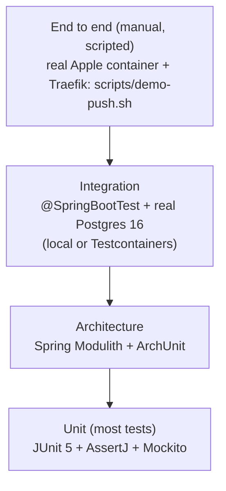
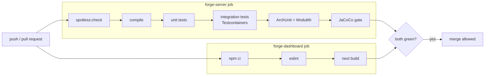

# 08 — Engineering Standards

The rules every change follows. Most of them are enforced by the build (`./mvnw verify`) and by CI ([`.github/workflows/ci.yml`](../.github/workflows/ci.yml)), so they are checked automatically.

## 1. Java code style

| Rule | Where you can see it |
|------|----------------------|
| Formatting is automatic: **Spotless + google-java-format 1.28** | `./mvnw spotless:apply`. `verify` runs `spotless:check`, so CI fails on unformatted code. |
| **Constructor injection only**, never `@Autowired` on fields | Every service, e.g. `DeploymentService`, `DefaultBuildService`. Fields are `final`, and classes are testable without Spring. |
| `record` for DTOs, events, commands and value objects | `CreateProjectCommand`, `DeploymentStatusChanged`, `BuildResult`, `Diagnosis`, `TokenPair`, `ContainerSpec` |
| Entities are **never** returned from controllers | Controllers map to response records (`DeploymentView`, `ProjectSnapshot`), so `passwordHash` or encrypted values can't leak. |
| No `null` from public methods | `Optional<T>` for "may be absent" (`UserLookup`, `ProjectCatalog`), empty lists for "none" |
| Validate at the boundary, re-check in the domain | `@Valid` + Jakarta constraints on requests; `Slug`, `RepoRef`, `BuildSettings` reject bad values in their constructors |
| Fail with domain exceptions | `NotFoundException`, `ValidationException`, `IllegalStateTransitionException`, `BuildFailedException`. All extend `ForgeException` and carry an `ErrorCode`. |
| No business logic in controllers | Controller = validate → one service call → map the response |
| `@Transactional` only on application services, and **never across network I/O** | Image builds, Git clones and health probes run outside transactions. `DeploymentTransitions` holds the short transactional steps. |
| No magic numbers | Typed `@ConfigurationProperties` records: `BuildProperties`, `DeploymentProperties`, `JobsProperties`, `RuntimeProperties`, `AgentProperties` |
| Logging: SLF4J with placeholders, **never secrets** | `CorrelationIdFilter` + `MdcScope` put `deploymentId`/`jobId` in every log line. `SecretRedactor` strips env-var values before logs reach the agent. |
| Java 21 where it clarifies | Records, sealed types, pattern-matching `switch`, text blocks, **virtual threads** (`spring.threads.virtual.enabled`, `JobRunner`) |

## 2. Architecture rules (enforced by tests)

[`ArchitectureTest`](../forge-server/src/test/java/com/forge/architecture/ArchitectureTest.java) fails the build when these are broken:

| Test | Rule |
|------|------|
| `modulesOnlyTalkThroughEachOthersPublicApi` | **Spring Modulith**: a module may use only the root package (public API) of another module, never its `application`/`domain`/`infrastructure` internals. No cycles. |
| `domainDoesNotDependOnWebOrAdapters` | **ArchUnit**: `..domain..` never imports `..api..`, `..infrastructure..`, Spring Web, docker-java or JGit. |
| `controllersNeverUseRepositoriesDirectly` | `..api..` classes go through an application service. |
| `onlyAdaptersTouchDockerAndGit` | docker-java and JGit are used only inside `infrastructure` adapters (and the shared Docker client config). The Apple container adapters use no library at all: only `ContainerCli` (in `shared.container`) starts `container` processes. |
| `documentModules` | Writes the module diagrams (PlantUML) into `target/spring-modulith-docs`. |

## 3. Testing strategy

| Layer | Tests | What they prove |
|-------|-------|-----------------|
| Unit | `DeploymentStatusTest`, `DeploymentTest` | Every allowed and forbidden state transition; terminal states; domain events |
| Unit | `ProjectDomainTest` | Slug, repo and build-setting validation |
| Unit | `EncryptionServiceTest` | AES-GCM round trip, random IV, tamper detection |
| Unit | `BuildChainTest`, `RetryingImageBuilderTest` | Detector chain picks the right build type; the decorator retries only transient failures |
| Unit | `DiagnosisRulesTest`, `SecretRedactorTest` | Each of the 13 agent rules fires on its evidence (a container-engine fault is never blamed on the code); secrets never reach the agent |
| Unit | `BackoffTest`, `TraefikLabelsTest` | Exponential backoff with cap; routing and retry labels (Docker engine) |
| Unit | `AppleRoutingTest` | Parses state, IP and labels from `container list` JSON; blue and green of one project share a route; stopped, foreign and address-less containers are not routed; the Traefik config has router, service, health check and retry; no running apps gives an empty config |
| Unit | `ListeningPortWatchTest` | Reads the port Node, Spring, Flask and Uvicorn announce; ignores lines that name no listening port |
| Unit | `SourceDomainTest` | Relinking GitHub replaces the account instead of adding one |
| Integration | `AuthFlowIntegrationTest` | Register, login, refresh rotation, **refresh-token reuse detection**, logout |
| Integration | `ProjectApiIntegrationTest` | CRUD, ownership (another user's project is 404), env-var masking, validation errors as ProblemDetail |
| Integration | `JobQueueConcurrencyIntegrationTest` | Many threads claim concurrently with `SKIP LOCKED`: **each job goes to exactly one worker**; lease expiry, retry and DEAD |
| Integration | `DeploymentPipelineIntegrationTest` | The whole pipeline through the real queue and DB (container engine and Git mocked at the port): LIVE, superseded, failed + insight, rollback, **self-healing recovery of a vanished container (once, without rebuilding)**, **canary that passes in steps (0 → 20 → 50 → 100%) and one rolled back on a higher error rate**, rollback of a canary project switching at once, **2 replicas and recovery of one lost replica**, cancel, one-in-progress rule |
| Integration | `WebhookIntegrationTest` | Bad HMAC rejected, duplicate delivery ignored, push to the tracked branch deploys |
| Integration | `RoutingIntegrationTest` | `GET /internal/routing` answers 401 without the routing token or with a wrong one, and 200 with the right one |
| Unit | `CanaryAnalysisTest` | Worse error rate or much slower → regression; errors the live version also has are not blamed on the new one; too little traffic is inconclusive |
| Unit | `AppleRoutingTest` | Versions become weighted Traefik services, replicas share one; a 0% canary gets no traffic; Traefik's Prometheus counters summed per version |
| Architecture | `ArchitectureTest` | Section 2 above |
| End to end | `scripts/demo-push.sh` on real Apple container (29 Oct) | Deploy, zero-downtime swap (402 requests, 0 errors), wrong-port and crash failures keep the old version with the right agent diagnosis, rollback in 4 s. Earlier on Docker (27 Oct): 4 swaps, 1,340 requests, 0 errors. |

**Totals:** 131 tests (98 unit/architecture + 33 integration), all green.

**Rules**
- Test names describe behaviour: `eachJobIsClaimedByExactlyOneOfManyWorkers`, `unhealthyNewVersionFailsAndTheOldOneKeepsServing`, `wrongPasswordAndUnknownUserGetTheSameAnswer`.
- Arrange / Act / Assert, one behaviour per test.
- Integration tests use a **real Postgres**, never H2: the local PostgreSQL 16 when `FORGE_TEST_DB_URL` is set (e.g. `jdbc:postgresql://localhost:5432/forge_test` on a Mac without Docker), otherwise a Testcontainers Postgres (CI). This matters because `SKIP LOCKED`, partial unique indexes and `CHECK` constraints are Postgres features.
- **Coverage gate (JaCoCo):** at least 80 % line coverage on every `com.forge.*.domain` package. `verify` fails below that.

## 4. Git workflow

- `main` is always green. Work happens on a branch (`feat/m1`) and is merged by PR.
- **Conventional Commits:** `feat(server): …`, `fix(runtime): …`, `docs: …`, `test(jobs): …`, `refactor: …`, `chore: …`.
- Each PR says *what*, *why* and *how it was tested*.
- `v1.0.0` is tagged for the evaluation build.

## 5. CI pipeline (GitHub Actions)

Test reports and the coverage report are uploaded as build artifacts.

## 6. Configuration and secrets

| Kind | Where |
|------|-------|
| Non-secret defaults | `application.yml` (`forge.*` sections), including `forge.engine` (`apple` by default, or `docker`) |
| Test overrides | `src/test/resources/application-test.yml` (random throwaway keys, job runner off) |
| Secrets: JWT key, AES master key, GitHub client secret, webhook secret, `ANTHROPIC_API_KEY`, routing token (`FORGE_ROUTING_TOKEN`) | **Environment only.** `.env` locally (git-ignored); `.env.example` documents the variables. `scripts/infra.sh up` generates `FORGE_ROUTING_TOKEN` into `.env` on first run. |
| Typed access | `@ConfigurationProperties` records with `@Validated`, e.g. `CryptoProperties` rejects a key that isn't 32 bytes at startup. |

## 7. API design rules

- Resource nouns under `/api/v1`: `/projects/{id}/deployments`, `/deployments/{id}/rollback`.
- Correct status codes: `201` create, `202 Accepted` for async deploys, `204` delete, `409` for conflicts, `422` for validation ([05](05-api-spec.md#5-http-status-codes-used)).
- Every error is an RFC 9457 `ProblemDetail` with a stable `code` and the request's `correlationId`.
- Lists are paginated (`PageResponse`).
- Swagger UI at `/swagger-ui.html`.

## 8. Database rules

- Flyway only (`V1`–`V9`). Never edit an applied migration. Hibernate runs with `ddl-auto: validate`, so a mapping that doesn't match the schema fails at startup.
- Every foreign key is indexed, and every list query has an index ([06 §4](06-database-schema.md#4-indexes-and-the-queries-they-serve)).
- Business invariants are enforced **in the database too**: `UNIQUE`, `CHECK`, and the partial unique index allowing one in-progress deployment per project.
- Optimistic locking (`@Version`) on aggregates that are updated concurrently.

## 9. Definition of Done

- [ ] Formatted, compiles, no new warnings
- [ ] Unit and integration tests written and passing; coverage gate green
- [ ] Error paths handled and tested, not only the happy path
- [ ] No secrets in code, logs or commits
- [ ] Docs and diagrams updated in the same change
- [ ] You can explain the change in two minutes without notes
