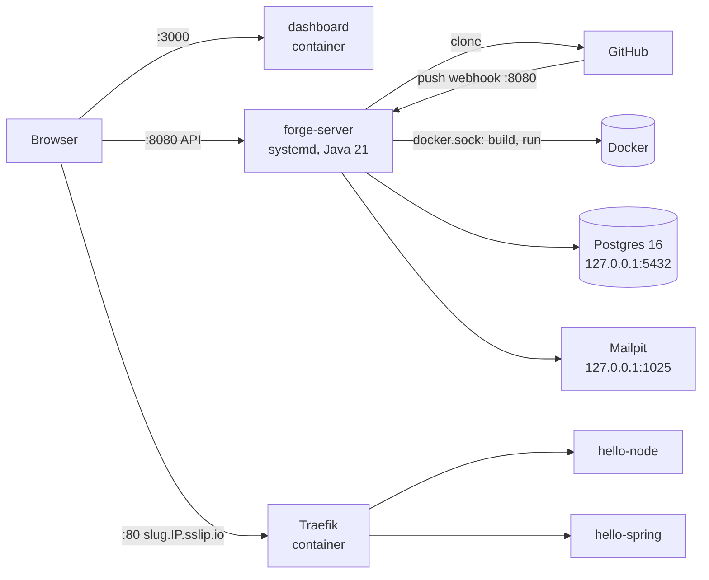

# 11 — Deploying Forge to a Server

How to run Forge itself on one public Linux server, so the dashboard and every deployed app have a real URL. Everything here runs **on the server**; your Mac only needs a browser and SSH.

> On the Mac, Forge uses Apple container ([D-004](DECISIONS.md)). Apple container exists only on macOS, so on a Linux server Forge uses its **Docker engine** (`FORGE_ENGINE=docker`). This needs no code change: it is the other adapter behind the same `ImageBuilder` and `RuntimeProvider` ports.

## 1. What you end up with



| URL | What |
|-----|------|
| `http://<IP>:3000` | Dashboard |
| `http://<IP>:8080/swagger-ui.html` | API docs |
| `http://<slug>.<IP>.sslip.io` | Each deployed project ([sslip.io](https://sslip.io) resolves any `*.<IP>.sslip.io` name to `<IP>`, so you need no domain and no DNS setup) |

Files used: [`infra/docker-compose.prod.yml`](../infra/docker-compose.prod.yml), [`deploy/forge-server.service`](../deploy/forge-server.service), [`deploy/env.production.example`](../deploy/env.production.example).

## 2. Pick a server

Needed: **Ubuntu 24.04, 2 vCPU, 4 GB RAM (8 GB is comfortable), 40 GB disk**, a public IPv4 address. Builds of Java apps are the heaviest part.

| Option | Cost | Notes |
|--------|------|-------|
| **DigitalOcean droplet, Bangalore (BLR1), Basic 4 GB / 2 vCPU** (recommended) | $24/month, covered by the $200 credit in the [GitHub Student Developer Pack](https://education.github.com/pack) | Simplest panel; x86 |
| AWS EC2 `t3.medium` in `ap-south-1` | ~$30/month or free credits | Open ports in the Security Group instead of ufw |
| Oracle Cloud Always Free, Ampere A1 (4 OCPU / 24 GB) | Free | ARM64 (all images used are multi-arch); free capacity is often unavailable |
| Hetzner CX22 (4 GB) | ~€4/month | EU only, so higher latency from India |

Create it with **your SSH key**, then note the public IP. Below, `203.0.113.10` stands for that IP: replace it everywhere.

## 3. Prepare the server (once)

```bash
ssh root@203.0.113.10
```

```bash
# Updates, Java 21, git, firewall
apt update && apt -y upgrade
apt -y install openjdk-21-jdk-headless git ufw curl

# Docker Engine + compose plugin
curl -fsSL https://get.docker.com | sh

# 2 GB swap so Maven builds don't hit out-of-memory on a 4 GB machine
fallocate -l 2G /swapfile && chmod 600 /swapfile && mkswap /swapfile && swapon /swapfile
echo '/swapfile none swap sw 0 0' >> /etc/fstab

# Firewall: SSH, apps, dashboard, API
ufw allow OpenSSH && ufw allow 80/tcp && ufw allow 3000/tcp && ufw allow 8080/tcp
ufw --force enable

# A non-root user that runs Forge and may use Docker
adduser --disabled-password --gecos "" forge
usermod -aG docker forge
mkdir -p /opt/forge /var/lib/forge/builds && chown -R forge:forge /opt/forge /var/lib/forge
```

Check: `java -version` shows 21, `docker version` shows a server version.

> Docker-published ports skip ufw. That is why the compose file binds Postgres, Mailpit and the Traefik dashboard to `127.0.0.1` only.

## 4. Get the code

The Forge repo is private, so log the server in to GitHub once:

```bash
apt -y install gh
su - forge
gh auth login            # GitHub.com → HTTPS → "Login with a web browser", enter the code on your Mac
gh repo clone sshivanshg/forge /opt/forge
cd /opt/forge && git checkout main   # merge PR #1 first: the deploy files live on feat/m1 until then
```

## 5. Configure secrets

```bash
cp deploy/env.production.example .env && chmod 600 .env
sed -i 's/203\.0\.113\.10/YOUR.REAL.IP.HERE/g' .env
openssl rand -base64 32   # → FORGE_ENCRYPTION_KEY
openssl rand -base64 32   # → FORGE_JWT_SECRET
openssl rand -hex 16      # → FORGE_DB_PASSWORD
openssl rand -hex 20      # → FORGE_GITHUB_WEBHOOK_SECRET (keep it, GitHub needs it in step 9)
nano .env                 # paste the values; leave the GitHub OAuth lines for step 9
```

Every `<...>` must be replaced or the line left empty (`FORGE_GITHUB_CLIENT_ID=`). The server refuses to start if the encryption key is not 32 bytes.

## 6. Start the infrastructure and the control plane

```bash
# Postgres, Traefik, Mailpit and the dashboard (the dashboard image builds here, ~3 min)
docker compose --env-file .env -f infra/docker-compose.prod.yml up -d --build
docker compose --env-file .env -f infra/docker-compose.prod.yml ps   # all "running"/"healthy"

# Build forge-server (tests already run in CI; skip them here to save time and memory)
cd forge-server && ./mvnw -B -ntp -DskipTests package && cd ..
cp forge-server/target/forge-server-*.jar /opt/forge/forge-server.jar
exit   # back to root
```

```bash
cp /opt/forge/deploy/forge-server.service /etc/systemd/system/
systemctl daemon-reload && systemctl enable --now forge-server
journalctl -u forge-server -f    # wait for "Started ForgeApplication", then Ctrl+C
```

Flyway creates the schema on first start.

## 7. Check it works

```bash
curl -s localhost:8080/actuator/health        # {"status":"UP",...}
```

On your Mac, open `http://203.0.113.10:3000`, **register** an account (e.g. `demo@forge.dev`), and log in.

## 8. Publish the sample apps as public GitHub repos

Run on the server as `forge` (`su - forge`), so nothing runs on the Mac:

```bash
for app in hello-node hello-spring; do
  rm -rf /tmp/$app && cp -R /opt/forge/sample-apps/$app /tmp/$app && cd /tmp/$app
  git init -q -b main && git add . && git -c user.name="Shivansh Gupta" -c user.email="you@example.com" commit -q -m "feat: initial version of $app"
  gh repo create sshivanshg/$app --public --source . --push
  cd ~
done
```

Public repos clone without a token, so deploying works even before the OAuth app exists.

## 9. Connect GitHub (webhook required, OAuth optional)

**Webhook (auto-deploy on push).** For each of the two repos: *Settings → Webhooks → Add webhook*

| Field | Value |
|-------|-------|
| Payload URL | `http://203.0.113.10:8080/api/v1/webhooks/github` |
| Content type | `application/json` |
| Secret | the `FORGE_GITHUB_WEBHOOK_SECRET` from `.env` |
| Events | *Just the push event* |

GitHub sends a ping first; Forge answers `202` and ignores it. The *Recent Deliveries* tab shows each delivery and Forge's response.

**OAuth app (the "Connect GitHub" button in Settings).** *GitHub → Settings → Developer settings → OAuth Apps → New OAuth App*

| Field | Value |
|-------|-------|
| Homepage URL | `http://203.0.113.10:3000` |
| Authorization callback URL | `http://203.0.113.10:8080/api/v1/github/callback` |

Copy the client ID and a new client secret into `.env`, then `systemctl restart forge-server`.

## 10. First deploys

In the dashboard:

1. **New project** → name `hello-node`, repo owner `sshivanshg`, repo `hello-node`, branch `main`, build type auto → **Deploy**. Live at `http://hello-node.203.0.113.10.sslip.io` in about a minute.
2. **New project** `hello-spring` → under **Environment**, add `GREETING=Hello from Spring Boot on Forge` → **Deploy**. The first Java build downloads the Maven image and takes a few minutes; later builds are faster.

## 11. Demo script on the live server

Edit the files straight in GitHub's web editor (pencil icon on `server.js` in `hello-node`), commit to `main`, and the webhook starts a deployment.

| Step | Change in `server.js` | What the audience sees |
|------|----------------------|------------------------|
| v2, zero downtime | `const version = "v1"` → `"v2"` | Pipeline runs; keep the app open in a tab and refresh: no error page, v1 then v2 |
| Broken port | `Number(process.env.PORT \|\| 8080)` → `3000` | Health check fails, **v2 keeps serving**, agent card: `PORT_MISMATCH`, high confidence |
| Crash on startup | Add `throw new Error("DATABASE_URL is not defined");` at the top | Fails fast, old version still up, agent: `MISSING_CONFIGURATION` |
| Fix | Revert the change (commit history → *Revert*, or edit back) | Deploys again |
| Rollback | Dashboard → an earlier LIVE deployment → **Rollback** | Live in seconds, no rebuild (image reused) |

Do one dry run the day before, so all base images are already downloaded on the server.

## 12. Updating Forge

```bash
su - forge
cd /opt/forge && git pull
cd forge-server && ./mvnw -B -ntp -DskipTests package && cp target/forge-server-*.jar /opt/forge/forge-server.jar && cd ..
docker compose --env-file .env -f infra/docker-compose.prod.yml up -d --build dashboard   # only if the dashboard changed
exit && systemctl restart forge-server
```

Running apps keep serving during a control-plane restart (Traefik routes on container labels), and a deployment that was mid-build is reclaimed by the job reaper when its lease expires.

## 13. Troubleshooting

| Symptom | Check |
|---------|-------|
| Dashboard loads but login fails with a network/CORS error | `FORGE_ALLOWED_ORIGINS` must be exactly `http://<IP>:3000`; `FORGE_PUBLIC_API_URL` was baked in at dashboard build time, so rebuild the dashboard after changing it |
| `forge-server` won't start | `journalctl -u forge-server -n 100`. Usually a missing secret in `.env` or Postgres not running |
| Build fails with "permission denied … docker.sock" | `forge` isn't in the `docker` group: `usermod -aG docker forge`, then restart the service |
| App URL shows Traefik's 404 | The deployment isn't LIVE yet, or the URL host doesn't match `<slug>.<FORGE_APPS_DOMAIN>` |
| Webhook delivery shows 401 | The secret on GitHub differs from `FORGE_GITHUB_WEBHOOK_SECRET` |
| Webhook delivered but nothing deploys | The push was to a branch the project doesn't track, or the repo owner/name in the project differs |
| Builds very slow or killed | `free -h`: add swap or use an 8 GB server; only 2 builds run at once (`forge.jobs.max-concurrent`) |
| Emails | `ssh -L 8025:127.0.0.1:8025 forge@<IP>`, then open `http://localhost:8025` on the Mac |
| Traefik dashboard | `ssh -L 8090:127.0.0.1:8090 forge@<IP>`, then `http://localhost:8090` |

## 14. Known limits of this setup (say them before you're asked)

- **HTTP, not HTTPS.** Fine for an evaluation. Production would put a domain with a wildcard DNS record in front and let Traefik get certificates from Let's Encrypt (a DNS challenge for the wildcard).
- **One server.** Postgres, the control plane and the apps share a machine. The way out is in [10 — Future work](10-roadmap.md#future-work-presented-not-built): managed Postgres (RDS), an image registry (ECR), separate build workers.
- **Docker isolation, not VM isolation.** On Linux, apps are containers sharing the kernel, hardened with `no-new-privileges`, a non-root user, a process limit, and memory and CPU limits. A promoted app gets the `unless-stopped` restart policy, so it comes back after a server reboot (Apple container has no restart policy). On the Mac, Apple container gives each app its own VM.
